# Talkback architecture

This document describes the code at commit `7158c68` on `main`. Every diagram and table was checked against the code.
Where it describes the author's Google Cloud deployment, it names the Cloud Run services and the Google Cloud products
used, but it leaves out project ids, URLs, accounts and other environment details. To run Talkback yourself you need
none of the cloud parts: see the [README quick start](../README.md#quick-start).

Talkback is a read-aloud book app. It reads novels and textbooks aloud with Boson Higgs TTS, with word
highlighting, character voices and lip-synced faces. The reader can stop and ask a question out loud. The answer
uses only the text the reader has reached (the spoiler rule), comes in the voice of the character or the narrator,
and then reading continues. Users can upload their own PDF or .txt books. Gemini on Vertex AI then finds the cast,
splits the dialogue by speaker, and writes recap notes. Textbooks get study notes, figures and LaTeX equations.

Related documents: [FEATURES.md](FEATURES.md) (every feature, with status and known gaps) and
[HOW-IT-WORKS.md](HOW-IT-WORKS.md) (how each feature works, step by step).

## Contents

1. [System context](#1-system-context)
2. [Deployment topology](#2-deployment-topology)
3. [Backend module map](#3-backend-module-map)
4. [Frontend module map](#4-frontend-module-map)
5. [Sequence: read mode](#5-sequence-read-mode)
6. [Sequence: hands-free spoken question](#6-sequence-hands-free-spoken-question)
7. [Sequence: push-to-talk, typed questions and reader tools](#7-sequence-push-to-talk-typed-questions-and-reader-tools)
8. [Upload and enrichment pipeline](#8-upload-and-enrichment-pipeline)
9. [Data model and storage](#9-data-model-and-storage)
10. [Security and cost controls](#10-security-and-cost-controls)
11. [External API calls](#11-external-api-calls)
12. [Key configuration settings](#12-key-configuration-settings)
13. [Notes](#13-notes)

## 1. System context

Who and what Talkback talks to. Keys stay on the server. The browser talks to Boson directly only over the Realtime
WebSocket, and it uses a 10-minute ephemeral key for that.

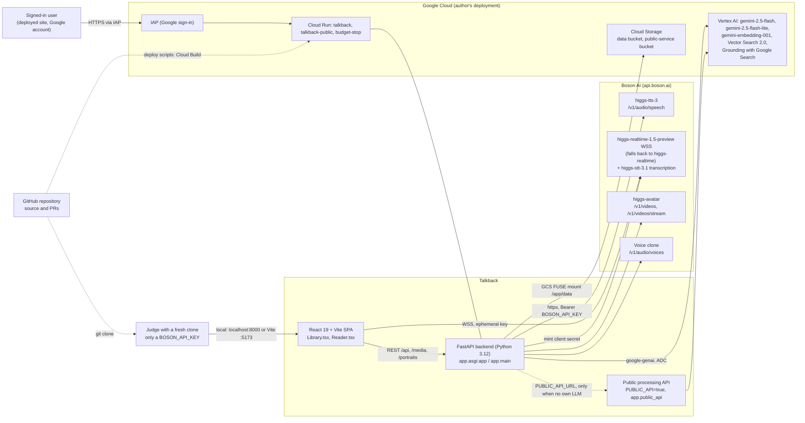

| Actor | How they use it |
| --- | --- |
| Signed-in user (owner, invited users) | The deployed site, behind IAP. Only accounts granted `roles/iap.httpsResourceAccessor` get in. `PER_USER=true` gives each account its own uploads, voices, faces and cast settings. |
| Judge with a fresh clone | Runs the backend (and optionally the Vite dev server) locally with only `BOSON_API_KEY`. If `PUBLIC_API_URL` is set and the machine has no Anthropic key, no `GEMINI_API_KEY` and no usable Google Cloud credentials, `public_client.active()` sends Gemini work (enrichment, typed answers, translation, detection, face box, equation readings) to `talkback-public`. |
| Boson AI | TTS, Realtime (speech-to-text, turn detection, function tools, spoken answers on the Realtime path), Avatar (lip-sync video), voice cloning. |
| Google Cloud | Hosting, sign-in, storage, Gemini, embeddings, vector search, web grounding, secrets, logs, budget kill switch. |
| GitHub | Source and PRs. Deploys are manual: `scripts/deploy_cloudrun.sh --yes` and `scripts/deploy_public_api.sh --yes`. There is no CI deploy. |

## 2. Deployment topology

### 2.1 Google Cloud (region `us-central1`)

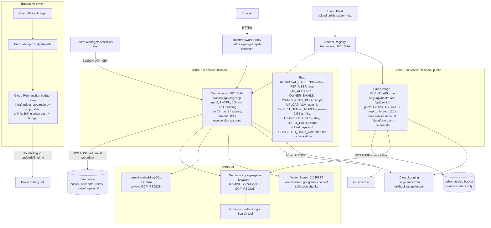

| Kind | Name | Notes |
| --- | --- | --- |
| Cloud Run | `talkback` | IAP on, max 1 instance, no CPU throttling, gen2, image tagged with the git short sha, request timeout 300 s, data bucket mounted at `/app/data`, secret env `BOSON_API_KEY` from `boson-api-key` |
| Cloud Run | `talkback-public` | no IAP, deployed with `--no-allow-unauthenticated` (closed until `allUsers` gets `roles/run.invoker`), own service account, timeout 120 s, a small bucket for spend counters |
| Cloud Run (function) | `budget-stop` | Cloud Functions gen 2, Pub/Sub trigger on `budget-alerts` |
| Pub/Sub | `budget-alerts` | budget notifications |
| Secret Manager | `boson-api-key` | the only secret |
| Artifact Registry | `talkback` (Docker) | image `api:<git short sha>` |

Image build (`Dockerfile`): stage 1 `node:22-slim` runs `npm ci && npm run build` (tsc + Vite). Stage 2 `python:3.12-slim`
runs `uv sync --frozen --no-dev` without the `embed` extra, so there is no torch and no e5 model in the cloud. The
built `frontend/dist` is served by the backend at `/` (`StaticFiles(html=True)`, mounted last). `data/` is not in the
image. The command is `uv run --frozen --no-dev --no-sync --project backend uvicorn --app-dir backend app.asgi:app --host 0.0.0.0 --port ${PORT}`.
No proxy-header flags are passed: with `TRUST_PROXY=true` the app reads the right-most `X-Forwarded-For` entry itself.

What `deploy_cloudrun.sh --yes` does: it refuses a dirty tree, checks the secret `boson-api-key`, and runs
`gcloud storage rsync data/books -> gs://<data bucket>/books`. It skips `u-*` uploads and `cast_settings.json`, never
deletes, and never syncs portraits. Then it runs `gcloud builds submit` and `gcloud run deploy` with the env above and
`--no-allow-unauthenticated --iap`. `deploy_public_api.sh` reuses the image when the tag exists and deploys closed.
Project, region and bucket are constants at the top of each script; see [DEPLOY.md](DEPLOY.md).

### 2.2 Local development

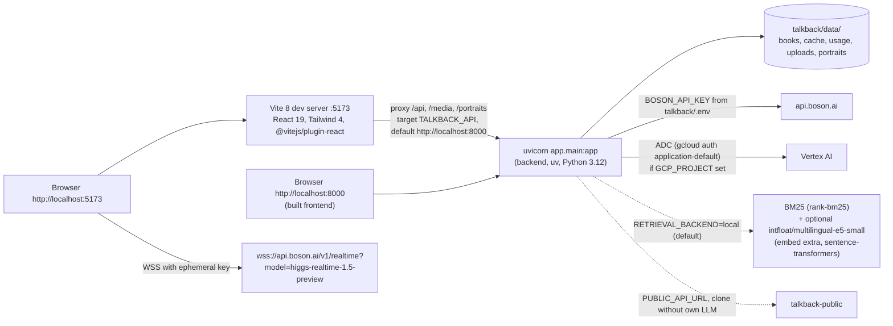

Local defaults (`backend/app/config.py`): `retrieval_backend=local`, so `answer_backend` resolves to `realtime`. Boson
Realtime then writes the spoken answer, unless `ANSWER_BACKEND=gemini` is set or the public processing service is
reachable (then Gemini on that service writes it). `per_user=false`, `usage_log_file=true` (`data/cache/usage.jsonl`),
`upload_llm=claude`, which falls back to Gemini because no `ANTHROPIC_API_KEY` is configured. With no `GCP_PROJECT`,
Gemini features are off unless the public API client is active. `.env.example` sets only `BOSON_API_KEY` and
`PUBLIC_API_URL`; every other setting is listed there commented out.

Local search is keyword search (BM25) by default. With the optional `embed` extra installed (`uv sync --extra embed`),
the server builds multilingual-e5 embeddings in the background, one book at a time: new uploads right after they are
published, and at startup any built-in book or older upload without `index/embeddings.npy` (gitignored). Search is
then hybrid BM25 + e5.

## 3. Backend module map

```mermaid
flowchart TB
  ASGI["asgi.py<br/>PUBLIC_API ? public_api.app : main.app"]
  MAIN["main.py + routes/ (FastAPI app, ~50 routes)<br/>deps.py: TokenBucket limits;<br/>processing.py: IngestGuard, background jobs, startup resume"]
  PAPI["public_api.py<br/>/api/public/* service"]
  ASGI --> MAIN
  ASGI --> PAPI

  subgraph CORE["Request-path core"]
    USERS["users.py<br/>IAP JWT verify, Identity contextvar,<br/>per-user paths, guard_book"]
    BOOKS["books.py<br/>load_book cache, write_lock,<br/>save_book atomic, auto rechunk,<br/>series index"]
    SCHEMA["schema.py (pydantic)<br/>Book, Paragraph, TtsChunk,<br/>MathBlock, Summary"]
    CFG["config.py<br/>pydantic-settings Settings"]
    RL["ratelimit.py TokenBucket, client_ip<br/>uploadlimit.py UploadSizeLimit<br/>daily_count.py DailyCount"]
  end

  subgraph VOICE["Voice and video"]
    BOSONC["boson.py BosonClient<br/>httpx, retries transient,<br/>never insufficient_quota"]
    TTSC["tts_cache.py<br/>sha256 key, align_timestamps"]
    TTSL["tts_lang.py ISO 639-3,<br/>timestamps: English only"]
    TCH["ttschunks.py<br/>280-char chunks, CHUNK_RULES_VERSION=2"]
    DEL["delivery.py<br/>style, sfx, singing, speed tags"]
    TXN["textnorm.py normalize_for_tts"]
    EMO["emotion.py<br/>sentence emotion markers"]
    VOI["voices.py presets + clones"]
    FACES["faces.py face library, animate loops"]
    CAST["cast.py per-book cast settings"]
    MP3["mp3dur.py"]
  end

  subgraph TALK["Talk answers"]
    RET["retrieval.py<br/>chunks, BM25 + e5 hybrid,<br/>spoiler _finish"]
    EMBL["embedder.py E5Embedder<br/>multilingual-e5-small"]
    PERS["personas.py<br/>build_instructions,<br/>build_answer_prompt"]
    ML["multilingual.py<br/>detect language, translate query"]
    WS["websearch.py<br/>grounding allowed + daily cap"]
    RECAP["recap.py scoped recaps"]
    PCL["public_client.py<br/>remote enrich / answer"]
  end

  subgraph GCPM["gcp/"]
    GLLM["gcp/llm.py GeminiAnswerer<br/>stream_sentences, google_search tool"]
    GEMB["gcp/embed.py GeminiEmbedder<br/>gemini-embedding-001"]
    VSTORE["gcp/vectorstore.py VectorStore<br/>REST, RRF, spoiler_filter"]
    VIDX["gcp/vertex_index.py VertexIndex<br/>post-filter"]
    GIDX["gcp/indexing.py index_book"]
    AUTH["gcp/auth.py ADC token"]
    USAGE["gcp/usage.py usage.record"]
  end

  subgraph ING["Upload ingest"]
    ING1["ingest/ (re-exported by ingest_upload.py)<br/>pymupdf PDF parsing (pdfdoc.py engine), figures,<br/>equation crops, status.json"]
    PARSE["parsing.py<br/>sections, paragraphs, markers"]
    FD["face_detect.py Gemini face box"]
  end

  subgraph ENR["enrich/"]
    PIPE["pipeline.py<br/>cast, segment, summaries, index"]
    ELLM["llm.py LLM, GeminiProvider,<br/>Claude provider, prices"]
    ECAST["cast.py"]
    ESEG["segment.py"]
    EATT["attribute.py"]
    EMIN["minor.py"]
    ESUM["summaries.py"]
    ETB["textbook.py"]
    EEQ["equations.py"]
    EDET["detect.py"]
    EDESC["describe.py"]
    ESE["series_early.py"]
    ESL["series_link.py"]
    ESP["spend.py upload_spend.json"]
  end

  PACER["pacer.py shared AIMD limiter<br/>interactive vs background"]
  RETRY["retrying.py backoff, transient vs quota"]

  MAIN --> USERS
  MAIN --> BOOKS
  MAIN --> RL
  MAIN --> BOSONC
  MAIN --> TTSC
  MAIN --> RET
  MAIN --> PERS
  MAIN --> ML
  MAIN --> WS
  MAIN --> EMO
  MAIN --> GLLM
  MAIN --> VIDX
  MAIN --> GIDX
  MAIN --> ING1
  MAIN --> PIPE
  MAIN --> PCL
  MAIN --> FACES
  MAIN --> CAST
  MAIN --> RECAP
  MAIN --> FD
  MAIN --> EEQ
  MAIN --> EDESC
  TTSC --> BOSONC
  TTSC --> TTSL
  TTSC --> DEL
  TTSC --> TXN
  BOOKS --> TCH
  TCH --> DEL
  BOOKS --> SCHEMA
  RET --> EMBL
  VIDX --> VSTORE
  VSTORE --> AUTH
  GIDX --> GEMB
  GIDX --> VSTORE
  GLLM --> PACER
  ML --> PACER
  FD --> PACER
  ELLM --> PACER
  PACER --> RETRY
  GEMB --> RETRY
  VSTORE --> RETRY
  PIPE --> ECAST
  PIPE --> ESEG
  PIPE --> EATT
  PIPE --> EMIN
  PIPE --> ESUM
  PIPE --> ETB
  PIPE --> ESL
  PIPE --> ESP
  PIPE --> TCH
  ECAST --> ELLM
  ESEG --> ELLM
  ESUM --> ELLM
  ETB --> ELLM
  EEQ --> ELLM
  EDET --> ELLM
  EDESC --> ELLM
  ESE --> ELLM
  ESL --> ELLM
  ING1 --> PARSE
  ING1 --> RET
  PAPI --> PIPE
  PAPI --> GLLM
  PAPI --> PERS
  PAPI --> EEQ
  PAPI --> FD
  PAPI --> ML
  GLLM --> USAGE
  GEMB --> USAGE
  BOSONC --> USAGE
  ELLM --> USAGE
```

### 3.1 Routes of the main app (`backend/app/routes/*.py`, mounted by `backend/app/main.py`)

Every route depends on `users.bind_identity`, which verifies the IAP JWT when `PER_USER=true`. The `require_access`
dependency checks the `X-Talkback-Token` header against `TALKBACK_ACCESS_TOKEN`, but only when that variable is set.
The deployed service does not set it: IAP is the gate there.

| Route | Purpose | Calls out to |
| --- | --- | --- |
| `GET /api/health` | `{ok, boson_key_set, access_required, answer_backend}`. The frontend picks the Gemini path or the Realtime path from `answer_backend` | public API health probe on a clone |
| `GET /api/me` | signed-in email and `per_user` | - |
| `GET /api/books`, `GET /api/hidden-books`, `POST /api/books/{id}/hide`, `/restore` | library listing, per-account hiding of built-in books | - |
| `GET /api/books/{id}` | full `book.json`, serialized and gzipped once per version (`_book_bodies`) | - |
| `GET /api/books/{id}/figures/{fig-N.png}` | textbook figure image | - |
| `GET /api/books/{id}/equations/{eN or mN}.png` | equation crop. Not behind the access code (it is an ``), but `guard_book` still applies | - |
| `GET /api/books/{id}/recap?para&scope&section` | spoiler-safe recap from stored summaries (`recap.py`, no LLM) | - |
| `POST /api/realtime/token` | mints an ephemeral Realtime key with a 600 s TTL | Boson `/v1/realtime/client_secrets` |
| `POST /api/tts` | read-mode chunk audio + word timestamps (cache first) | Boson `higgs-tts-3` |
| `POST /api/retrieve` | Realtime path: spoiler-safe passages + persona instructions (k at most 4, 4,500 chars) | Gemini translate (non-English), Vertex embeddings + Vector Search |
| `POST /api/answer` | Gemini path: NDJSON stream `sentence` / `sources` / `done` / `error` | translate, embeddings, Vector Search, `gemini-2.5-flash` (+ Google Search) or public API |
| `POST /api/speak` | TTS of one answer or recap sentence (at most 400 chars), with an emotion tag and an optional language | Boson `higgs-tts-3` |
| `POST /api/books/upload` (202) | PDF/.txt upload, 20 MB max, starts the background `_ingest` | see section 8 |
| `POST /api/books/describe` | title and author for the Add-book form | Gemini (enrich model) |
| `GET /api/books/{id}/status` | ingest / index / enrich / delete status | - |
| `POST /api/books/{id}/enrich` (202) | confirm or retry enrichment (at most 3 retries) | Gemini |
| `POST /api/books/{id}/kind` (202) | move a book between Novels and Textbooks, re-reading the PDF and re-indexing | Vertex, Gemini |
| `DELETE /api/books/{id}` (202) | owner-only delete: tombstone, then Vertex DELETEs in the background | Vector Search |
| `GET /api/avatars/{book}`, `GET /api/avatar/{chunk}?book=` | pre-rendered read-mode clips (cache only) | - |
| `POST /api/avatar/talk` | render one lip-sync clip (render, poll, download) | Boson `higgs-avatar` `/v1/videos` |
| `POST /api/avatar/stream` | proxy Boson's fragmented MP4 stream, teed to the cache | Boson `/v1/videos/stream` |
| `POST /api/voices/clone`, `DELETE /api/voices/{id}`, `GET /api/voices`, `GET /api/voices/faces` | voice cloning and listing | Boson `/v1/audio/voices` |
| `POST /api/faces`, `GET /api/faces`, `DELETE /api/faces/{id}`, `POST /api/faces/{id}/animate`, `POST /api/faces/detect` | face library, talk and idle loops, face box | Boson TTS + avatar, Gemini |
| `GET/PUT /api/books/{id}/cast` | per-book cast settings | - |
| static `/media/tts`, `/media/avatar` (`LipsyncFiles`, per-user), `/portraits` (`PortraitFiles`, per-user), `/` (frontend dist) | | - |

Public service (`backend/app/public_api.py`, `PUBLIC_API=true`): `GET /api/health`, `POST /api/public/enrich`,
`GET /api/public/enrich/{job_id}`, `POST /api/public/answer`, `/translate`, `/detect`, `/describe`, `/series`,
`/series-early`, `/faces/detect`, `/equations`, `/equations/{ticket}`. Everything else returns 404. Request bodies are
never logged. Results are held in memory for 30 minutes. The only files written are spend counters.

## 4. Frontend module map

Stack: React 19.2, TypeScript 6, Vite 8, Tailwind 4, KaTeX 0.16, Vitest + jsdom. There is no router library and no
state library.

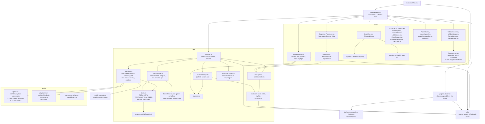

`TalkController` states (`TalkState`):

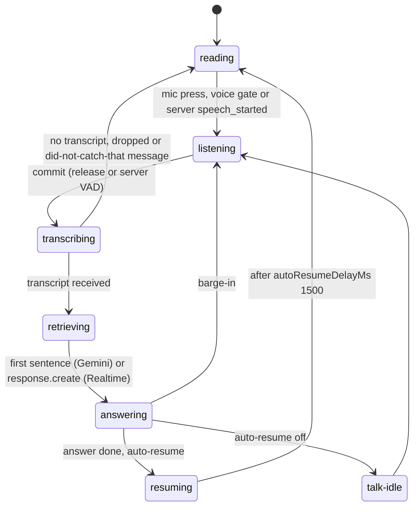

## 5. Sequence: read mode

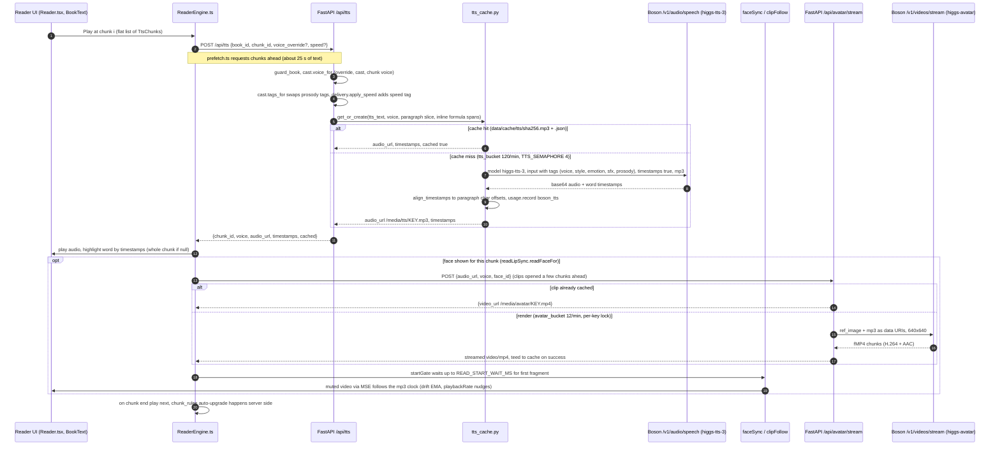

Read-mode details:

- TTS chunks are at most 280 characters and sentence-aligned (`ttschunks.MAX_CHARS`). A speaker uses the same voice on
  every chunk. A book whose `chunk_rules` is lower than `CHUNK_RULES_VERSION=2` is rechunked once on a background
  thread (`books.schedule_all_upgrades` / `_schedule_upgrade`) with no API call. Changed chunks get new audio the
  next time they are played.
- Boson tags come from `delivery.py` (styles whispering and shouting, sfx such as laughter, sigh, sneeze and humming,
  singing, pauses, expressive) and from the cast prosody tags (`pitch_low`, `pitch_high`, `speed_slow`, `speed_fast`). Natural speed adds a `prosody:speed_*` tag and so gets its own cache entry.
- Code listings read "Code listing skipped.". A display equation reads its Gemini `spoken` text, else "Equation.".
  An inline formula's reading replaces its garbled glyphs, and `inline_spans` keeps word highlighting aligned.

## 6. Sequence: hands-free spoken question

This is the cloud configuration: `answer_backend=gemini`, server turn detection.

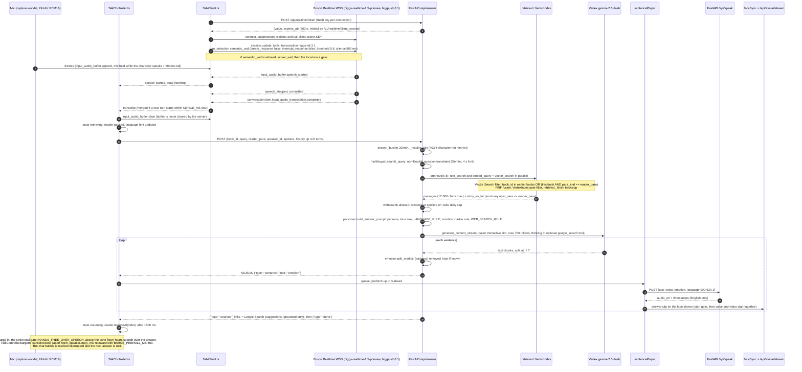

On the Realtime answer path (the local default), step 13 calls `POST /api/retrieve` instead. It returns `instructions`
(k at most 4, at most 8,000 chars, including the chat so far, `LANGUAGE_RULE` and, in text mode, the spoken-output and
`[feeling]` marker rule). `TalkClient.respond` then sends `response.create {instructions, input: [the question],
max_output_tokens 600}`. By default Boson speaks the answer itself through the playback worklet. With `?answers=text` the session is in
text mode (`output_modalities: ["text"]`): the answer streams back
as text, is split into sentences in the browser and each sentence is voiced by Higgs TTS with its emotion tag in the
speaker's voice and lip-synced, exactly like steps 17-23 of the Gemini path (see HOW-IT-WORKS 12.1). Every server event carries a
`response_id`. `TalkClient.stale()` drops output from a cancelled or older response, and `dropOutput` stays on until the
next `response.created`. A barge-in on that path calls `interrupt()`: it stops the sentence player (or flushes
local playback and sends `conversation.item.truncate` at the played position), then `response.cancel`, and waits for
the acknowledgement.

## 7. Sequence: push-to-talk, typed questions and reader tools

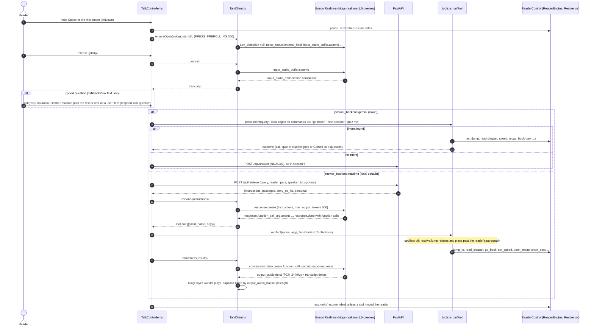

Tool sets declared to `session.update` (`tools.toolDefsFor(kind)`):

- Novels (`TOOL_DEFS`): `jump_to`, `read_chapter`, `resume_reading`, `pause_reading`, `set_voice_mode`, `set_narrator`,
  `set_speed`, `open_recap`, `bookmark`, `show_cast`, `go_back`.
- Textbooks (`TEXTBOOK_TOOL_DEFS`): `jump_to`, `read_chapter`, `next_section`, `previous_section`, `find_topic`
 (tf-idf in `sections.ts`), `quiz_me` (3 questions), `explain_here`, `resume_reading`, `pause_reading`, `set_speed`,
  `open_recap`, `bookmark`, plus `go_back`.
- Boson's server-side `{"type": "web_search"}` tool is added for textbooks, and for novels only with spoilers on
  (`talk/webSearch.ts`, rebuilt before every turn). A web search about a spoiler-safe novel would give away spoilers.

## 8. Upload and enrichment pipeline

```mermaid
flowchart TB
  UP["POST /api/books/upload<br/>multipart file, title, author, kind auto|novel|textbook"] --> CHK["upload_bucket 6/min, IngestGuard (6 in flight),<br/>UploadSizeLimit + 20 MB read, %PDF magic,<br/>sha256 duplicate check (upload_hashes.json, 409)"]
  CHK --> SAVE["make_book_dir u-slug-hex, users.claim_book (owner.txt),<br/>data/uploads/ID.pdf, status processing Queued"]
  SAVE --> BG["BackgroundTasks: _ingest (INGEST_CONCURRENCY 2)"]
  BG --> EXT["ingest_upload.extract_text<br/>pymupdf: headers/footers, columns, headings,<br/>code, display + inline math markers, figures to PNG"]
  EXT --> DET{"kind auto?"}
  DET -->|"yes"| KIND["enrich/detect.detect_kind<br/>Gemini fast tier on 3 x 1,000-char samples,<br/>heuristic fallback"]
  DET -->|"no"| BUILD
  KIND --> BUILD["process_upload: parsing.parse, build_book,<br/>TTS chunks (narrator marcus), retrieval.make_chunks,<br/>index/chunks.json"]
  BUILD --> PUBL["publish_book: book.json written atomically<br/>book is readable now, BM25 search"]
  PUBL --> EQJ{"textbook PDF<br/>with math?"}
  EQJ -->|"yes"| EQ["_equations_job: render_equations, render_inline crops (200 dpi),<br/>enrich/equations.transcribe, Gemini image batches of 8,<br/>LaTeX + spoken reading, update_equations"]
  PUBL --> SER{"novel?"}
  SER -->|"yes"| SE["series_early.detect_default<br/>one cheap call: series + series_index"]
  PUBL --> IDX{"RETRIEVAL_BACKEND vertex?"}
  IDX -->|"yes"| VI["_index_in_background (INDEX_CONCURRENCY 2)<br/>gcp/indexing.index_book: embed batches of 100 (5 in flight),<br/>upsert batchCreate (4 in flight), progress in status.json every 2 s"]
  PUBL --> PLAN{"UPLOAD_ENRICH?"}
  PLAN -->|"yes"| CAP["_decide_enrichment: estimate_for + check_caps<br/>(book cap, total cap, already spent)"]
  CAP -->|"over cap"| REF["enrich refused, narrator only"]
  CAP -->|"UPLOAD_CONFIRM"| WAIT["awaiting_confirmation<br/>POST /api/books/ID/enrich"]
  CAP -->|"ok"| RUN["_run_enrichment under _enrich_lock (ENRICH_PARALLEL 1000)"]
  WAIT --> RUN
  RUN --> TB{"textbook?"}
  TB -->|"yes"| TBN["enrich_textbook: chapter + subsection study notes<br/>Summary with section_id"]
  TB -->|"no"| ST1["cast: cast_novel, one smart-tier call (300k chars max),<br/>at most 8 main characters, voices + prosody tags, series"]
  ST1 --> CP1["checkpoint: save_book"]
  CP1 --> ST2["segment: batches of 10 quoted paragraphs, UPLOAD_CONCURRENCY 24,<br/>verbatim tiling check, retry alone, narrator fallback"]
  ST2 --> ST2B["attribute_speakers + minor voices (free, offline),<br/>rechunk_book (stamps chunk_rules)"]
  ST2B --> CP2["checkpoint"]
  CP2 --> ST3["summaries: parallel chapter units (200 paras / 60k chars),<br/>checkpoint note every 40 paras, condensations"]
  ST3 --> CP3["checkpoint (must land)"]
  CP3 --> ST4["index: _enrich_indexer re-embeds with speakers<br/>(failure means BM25 until next start)"]
  ST4 --> SL["series_link: same-author checks (at most 5)"]
  SL --> DONE["enrich done: Characters, recap and search are ready"]

  subgraph LIMITS["Shared throttles"]
    PCR["pacer.shared: AIMD start 8, max 32, halve on 429,<br/>1 slot reserved for interactive calls"]
    RTY["retries: background 6 attempts up to 30 s, interactive 4 attempts up to 8 s"]
    SPD["spend.py: data/usage/upload_spend.json,<br/>SpendLimit at the total cap or 1.25 x the book cap"]
  end
  ST1 -.-> PCR
  ST2 -.-> PCR
  ST3 -.-> PCR
  TBN -.-> PCR
  EQ -.-> PCR
  PCR -.-> RTY
  ST1 -.-> SPD

  subgraph RESTART["On startup (main.lifespan)"]
    MIG["users.migrate_on_startup"]
    WARM["_warm_up: schedule rechunks, load indexes,<br/>warm the Vertex embedder, series_link.startup_default"]
    RES["_resume_enrichments: status running or queued gives resume=True,<br/>owner ns from owner.txt, enrich_retries+1 (max 3), caps re-checked,<br/>finished stages are skipped"]
    RIX["_retry_failed_indexes: index state error,<br/>up to 20 per start"]
  end
```

Enrichment status (`status.json.enrich.status`) as a state machine:

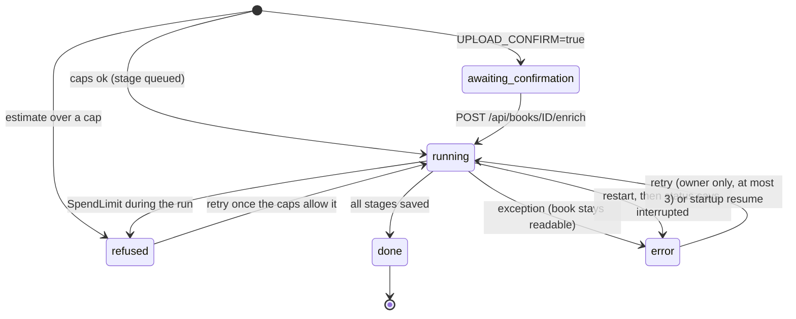

Notes:

- `stage` runs `queued`, `cast`, `segment`, `summaries`, `index`, `done`. Progress weights are cast 0.10, segment
  0.55, summaries 0.30, index 0.05. Textbooks report `summaries_only: true`.
- Vertex index progress is kept separately in `status.json.index` (`queued | running | done | error`). Retrieval
  serves local BM25 from `index/chunks.json` until the state is `done` (`_vertex_index_ready`).
- On a clone with only a Boson key (`public_client.active()`), the same stages run on `talkback-public`. The client
  polls `GET /api/public/enrich/{job}` and re-validates every segment against its own text. If the service is closed
  or capped, the book falls back to `cast_mod.fallback_cast`, with a message that says why.

## 9. Data model and storage

### 9.1 `book.json` (`backend/app/schema.py`)

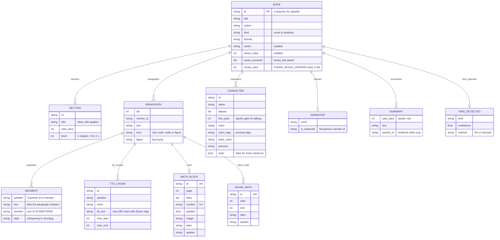

### 9.2 Files on disk (`DATA_DIR`: `talkback/data` locally, `/app/data` = the data bucket on Cloud Run)

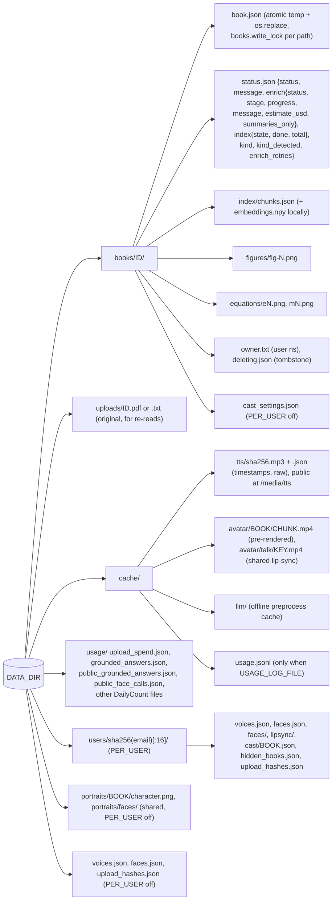

Cache keys and identities:

- TTS cache key is `sha256(json([model, tts_text, voice, fmt, timestamps] + [language, has_timestamps] for non-English))`.
  The same chunk text and voice is never paid for twice. A per-key `asyncio.Lock` shares one Boson call between
  concurrent requests.
- Lip-sync clip key is `TTS key + "-" + sha256(face image)[:16]`. A per-key lock with a waiter count stops two renders of
  the same clip.
- Vector Search data object id is `BOOK__CHUNK`. Its `data` holds `book_id, chunk_id, section, para_start, para_end, speaker, text`.
- In memory: `books._cache` (keyed by mtime and size), `deps._book_bodies` (JSON + gzip), `_index_for` (LRU 8),
  `_upload_status`, the job sets (`_enrich_jobs`, `_index_jobs`, `_equation_jobs`, `_kind_claims`, `_deleted`), and the
  translation cache (256 entries).

## 10. Security and cost controls

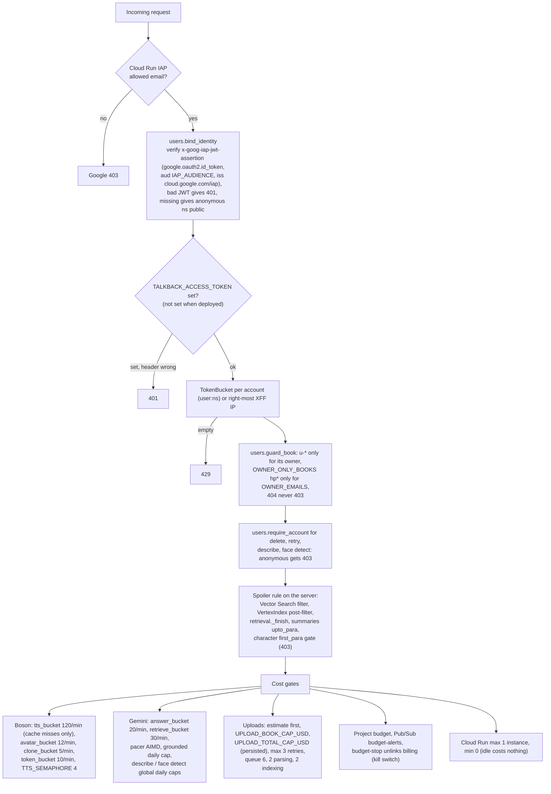

| Control | Where | Detail |
| --- | --- | --- |
| Google sign-in | Cloud Run `--iap` | only `roles/iap.httpsResourceAccessor` members. The app verifies the JWT itself and never trusts `x-goog-authenticated-user-email`. Certs come from `https://www.gstatic.com/iap/verify/public_key` (1 h TTL; results cached up to 300 s) |
| Per-user isolation | `users.py` | namespace `sha256(email)[:16]`. Voices, faces, lip-sync clips, cast settings, hidden books and upload hashes live under `data/users/<ns>/`. `PortraitFiles` and `LipsyncFiles` serve only the caller's files. Background jobs restore the owner identity from `owner.txt` |
| Book visibility | `guard_book`, `can_see_book` | another account's upload gives 404. `hp*` books are owner-only. Delete checks `book_owner_ns` again |
| Write safety | `books.write_lock` (RLock per path), `save_book` (unique temp + `os.replace`, Windows PermissionError retried for 3 s), `update_book` (read-modify-write under the lock) | every writer of `book.json` (rechunk upgrade, equations, textbook notes, kind change, enrich checkpoints, ingest) shares one lock |
| Job dedup | `_enrich_jobs`, `_index_jobs`, `_kind_claims`, `_equation_jobs`, `_hash_claims`, `_deleted` | synchronous check-and-claim stops two paid jobs on one book. Deleted ids are never written back |
| Secrets | Secret Manager `boson-api-key`, env only | the key never reaches the browser. The browser gets only a 600 s Realtime client secret. Settings use `repr=False`. Errors return `type(e).__name__`, never the message |
| Upload abuse | `UploadSizeLimit` middleware (Content-Length plus 1 MB slack), bounded `file.read`, `%PDF` magic, page, char and paragraph caps (2,000 pages, 5 M chars, 5,000 chars per paragraph) | |
| Untrusted model output | `emotion.strip_tags` (no Boson tag injection into TTS), KaTeX `trust` off, Search Suggestions in a sandboxed iframe, `websearch.clean_sources` (http(s) only, at most 5) | |
| Web search | `websearch.allowed` | only textbooks and novels with spoilers on. A spoiler-safe novel never gets the Google Search tool. Daily cap in `data/usage/grounded_answers.json` |
| Spend caps | `enrich/spend.py`, `public_api.py` | configurable. Code defaults: 4 USD per book and 15 USD total for uploads; 1.5 / 10 / 2 / 2 USD on the public service (per book, total, per IP per day, answers per day). The hackathon deploy scripts lift all of them to 1000 USD (export lower values before deploying to restore them), so the project budget is the real guard there |
| Kill switches | `budget-stop` function, closing `talkback-public` (remove the `allUsers` invoker), `UPLOAD_ENRICH=false`, `WEB_SEARCH=false`, `--no-iap` toggle | |

Rate limits in `deps.py` (per account or per IP, per 60 s unless noted): token 10, tts 120 (cache misses only), clone 5,
answer 20, retrieve 30, upload 6, describe 12, avatar 12, face upload 10, face detect 12. The public service has its
own buckets: enrich 1 per IP per hour, poll 120, answer 20, small 30, face 10 per hour, equation tickets 2 per hour,
equation requests 60.

## 11. External API calls

| Called by | Route / module | Endpoint | Model | Purpose |
| --- | --- | --- | --- | --- |
| Backend | `/api/tts` -> `tts_cache.get_or_create` -> `BosonClient.create_speech` | `POST api.boson.ai/v1/audio/speech` | `higgs-tts-3` | read-mode chunk audio, mp3, `timestamps: true` |
| Backend | `/api/speak` -> `tts_cache` | same | `higgs-tts-3` | answer and recap sentences, `<\|emotion:x\|>` tag, `language` (ISO 639-3); non-English sent with `normalize: true` and no timestamps |
| Backend | `faces.animate` (`/api/faces/{id}/animate`) | `/v1/audio/speech` then `/v1/videos` x2 | `higgs-tts-3`, `higgs-avatar` | face talk and idle loops (about 0.05 USD) |
| Backend | `/api/avatar/talk` | `POST /v1/videos`, `GET /v1/videos/{id}`, `GET /v1/videos/{id}/content` | `higgs-avatar` `AVATAR_SIZE` (default 640x640; 480x640 is $0.07/min) | one lip-sync clip (render, then download) |
| Backend | `/api/avatar/stream` | `POST /v1/videos/stream` | `higgs-avatar` | streaming fMP4 (H.264 High 3.0 + AAC-LC), proxied to MSE |
| Backend | `/api/voices/clone`, `DELETE /api/voices/{id}` | `POST/DELETE /v1/audio/voices` | voice clone | user voice clones (WAV at least 3 s, consent) |
| Backend | `/api/realtime/token` | `POST /v1/realtime/client_secrets` | - | ephemeral key, `expires_after` 600 s |
| Browser | `TalkClient.open` | `wss://api.boson.ai/v1/realtime?model=higgs-realtime-1.5-preview` (fallback `higgs-realtime`; `?rt=` overrides) | `higgs-realtime-1.5-preview`, `higgs-stt-3.1` | speech in, transcripts, semantic_vad / server_vad turns, function tools, spoken answers (Realtime path) |
| Backend | `/api/answer` -> `GeminiAnswerer.stream_sentences` | Vertex `generate_content_stream` | `GEMINI_MODEL` (default `gemini-2.5-flash`) | in-character spoken answer. Optional `GoogleSearch` grounding tool. Location `GEMINI_LOCATION` or `GCP_REGION` |
| Backend | `multilingual.translate` (from `/api/answer`, `/api/retrieve`) | Vertex `generate_content` | `GEMINI_MODEL` | non-English question to English for search (4 s limit) |
| Backend | `face_detect.detect` (`/api/faces/detect`) | Vertex `generate_content` with an image part | `GEMINI_MODEL` | face bounding box for the crop |
| Backend | `enrich.llm.GeminiProvider` (cast, segment, summaries, textbook notes, equations, detect, describe, series_early, series_link) | Vertex `generate_content`, JSON schema output | `ENRICH_GEMINI_MODEL` (deployed: `gemini-2.5-flash-lite`), else `GEMINI_MODEL` | book enrichment |
| Backend | `gcp/embed.GeminiEmbedder` (indexing, `VertexIndex.asearch`) | Vertex `embed_content` | `gemini-embedding-001`, 768 dims, `RETRIEVAL_DOCUMENT` / `RETRIEVAL_QUERY` | chunk and question embeddings (region `GCP_REGION`) |
| Backend | `gcp/vectorstore.VectorStore` | `vectorsearch.googleapis.com/v1/.../collections/chunks/dataObjects:batchCreate`, `:search`, `DELETE dataObjects/{id}` | Vector Search 2.0 | upsert, vector + text search (RRF), delete |
| Backend | `users.verify_email` | `https://www.gstatic.com/iap/verify/public_key` | - | IAP JWT signing keys |
| Backend (clone) | `public_client` | `talkback-public /api/public/*` | Gemini on the service | enrich, answer, translate, detect, describe, series, faces, equations |
| Backend (optional) | `enrich.llm` Claude provider | Anthropic Messages API | `claude-haiku-5-5`, `claude-sonnet-5-5` | only if `ANTHROPIC_API_KEY` is set. It is not configured anywhere now |
| Backend (local, optional) | `embedder.E5Embedder` | Hugging Face model download (sentence-transformers) | `intfloat/multilingual-e5-small` | local hybrid retrieval when the `embed` extra is installed |
| `budget-stop` function | `stop_billing` | Cloud Billing API v1 `projects.updateBillingInfo` | - | unlink billing at 100% of the budget |
| Browser | `SourceLinks.tsx` | Google Search Suggestions markup in a sandboxed iframe; chips open google.com | - | required display for grounded answers |

## 12. Key configuration settings

All settings are in `backend/app/config.py` (pydantic-settings, read from `talkback/.env`). "Local" means the code
default, which is what a fresh clone gets. "Cloud" means what the deploy scripts set for the `talkback` service unless
noted. The cap columns show the deployed values; the code defaults are the safe ones.

| Setting (env) | Code default / local | Cloud `talkback` | Cloud `talkback-public` | Effect |
| --- | --- | --- | --- | --- |
| `BOSON_API_KEY` | from `.env` | Secret `boson-api-key:latest` | none | Boson access |
| `BOSON_BASE_URL` | `https://api.boson.ai` | default | default | |
| `ANTHROPIC_API_KEY` | empty | unset | unset | Claude provider. If empty, Gemini is used |
| `DATA_DIR` | `talkback/data` | `/app/data` (Dockerfile) | `/app/data` | |
| `TALKBACK_ACCESS_TOKEN` / `ACCESS_TOKEN` | empty | unset | unset | optional `X-Talkback-Token` gate |
| `TRUST_PROXY` | false | true | true | right-most `X-Forwarded-For` |
| `CORS_ORIGINS` | `http://localhost:5173` | `http://localhost:5173` | default | |
| `GCP_PROJECT` | empty | the author's project | the author's project | |
| `GCP_REGION` | `us-central1` | `us-central1` | `us-central1` | embeddings and Vector Search always use this |
| `GEMINI_LOCATION` | empty (so `GCP_REGION`) | unset (so us-central1) | unset | `global` is needed for Gemini 3 models on a new project |
| `GCP_BUCKET` | empty | unset (the bucket is a volume mount) | unset | not used by the request paths (the bucket is a volume mount) |
| `RETRIEVAL_BACKEND` | `local` | `vertex` | default | Vertex index or BM25 + e5 |
| `ANSWER_BACKEND` | None (vertex gives gemini, local gives realtime) | unset, so `gemini` | n/a | who writes Talk answers |
| `GEMINI_MODEL` | `gemini-2.5-flash` | default | default | answers, translation, face box |
| `ENRICH_GEMINI_MODEL` | empty (so `GEMINI_MODEL`) | `gemini-2.5-flash-lite` | `gemini-2.5-flash-lite` | book processing |
| `WEB_SEARCH` | true | default | default | grounding allowed |
| `GROUNDED_DAILY_CAP` | 100 | 100000 | n/a | grounded answers per UTC day |
| `PUBLIC_GROUNDED_DAILY_CAP` | 50 | n/a | default 50 | |
| `VS_COLLECTION` | `chunks` | default | n/a | Vector Search collection |
| `USAGE_LOG_FILE` | true | false (Cloud Logging only) | false | `data/cache/usage.jsonl` |
| `UPLOAD_ENRICH` | true | true | n/a | |
| `AUTO_RECHUNK` | true | default | n/a | |
| `MINOR_VOICES` | true | default | n/a | two stand-in voices for uncast speakers |
| `UPLOAD_LLM` | `claude` (falls back to gemini without a key) | `gemini` | `gemini` | |
| `UPLOAD_CONFIRM` | false | false | n/a | testing mode |
| `UPLOAD_CONCURRENCY` | 24 | default | default | LLM calls per book |
| `ENRICH_PARALLEL` | 1000 | default | n/a | uploads enriched at once |
| `GEMINI_CONCURRENCY_START` / `_MAX` | 8 / 32 | default | default | pacer AIMD |
| `UPLOAD_BOOK_CAP_USD` / `UPLOAD_TOTAL_CAP_USD` | 4.0 / 15.0 | 1000 / 1000 (overridable at deploy) | n/a | per-book estimate cap / cumulative cap |
| `PUBLIC_API` | false | false | true | public-only app |
| `PUBLIC_API_URL` | empty (`.env.example` sets it for clones) | unset | n/a | clone client |
| `PUBLIC_BOOK_CAP_USD`, `PUBLIC_TOTAL_CAP_USD`, `PUBLIC_IP_DAILY_CAP_USD`, `PUBLIC_ANSWER_DAILY_CAP_USD` | 1.5, 10, 2, 2 | n/a | 1000 each (overridable at deploy) | |
| `PER_USER` | false | true | n/a | requires `IAP_AUDIENCE` (validator) |
| `IAP_AUDIENCE` | empty | `/projects/PROJECT_NUMBER/locations/REGION/services/talkback` (set by the deploy script) | n/a | |
| `OWNER_EMAILS` | empty | the author's account | n/a | the first one inherits pre-account data |
| `OWNER_ONLY_BOOKS` | empty | `hp*` | n/a | the Harry Potter books stay private |

Frontend: `TALKBACK_API` (Vite proxy target, default `http://localhost:8000`). URL flag `?gate=local` or
localStorage `talkback:gate=local` forces the local voice gate. Debug drawer flag is in `ui/debugFlag.ts`.

Hard-coded constants worth knowing: `retrieval.DEFAULT_K=8`, `MAX_PASSAGE_CHARS=12000`, `REALTIME_K=4`,
`REALTIME_MAX_PASSAGE_CHARS=4500`, chunks of 1,400 chars (900 to 2,000, overlap 250), hybrid weights 0.6 embedding /
0.4 BM25 (local), RRF k=60 (Vertex), `personas.MAX_INSTRUCTIONS_CHARS=8000`, `MAX_ANSWER_PROMPT_CHARS=24000`,
`ttschunks.MAX_CHARS=280`, `CHUNK_RULES_VERSION=2`, `ingest_upload.MAX_UPLOAD_BYTES=20 MB`, `NARRATOR_VOICE=marcus`,
preset voices `default, chloe, eleanor, jake, marcus, nora, oliver`, `AUDIO_RATE=24000`.

## 13. Notes

- Deploys are manual (`scripts/deploy_cloudrun.sh --yes`, `scripts/deploy_public_api.sh --yes`). There is no CI deploy.
- The project-level budget and its kill switch are set up outside the repository (Cloud Billing budget, Pub/Sub topic,
  `infra/budget_stop`). Their amounts are account settings, not code.
- `GCP_BUCKET` is accepted by the settings but not used by the request paths: on Cloud Run the data bucket is a volume
  mount at `/app/data`.
- The Realtime event names for function calls (`response.function_call_arguments.*`) are summarized from
  `frontend/src/talk/TalkClient.ts`. `frontend/src/realtime/events.ts` has the full list.
- Known limitations are listed in [HOW-IT-WORKS.md](HOW-IT-WORKS.md#24-known-limitations) and
  [FEATURES.md](FEATURES.md#known-gaps--not-built).
