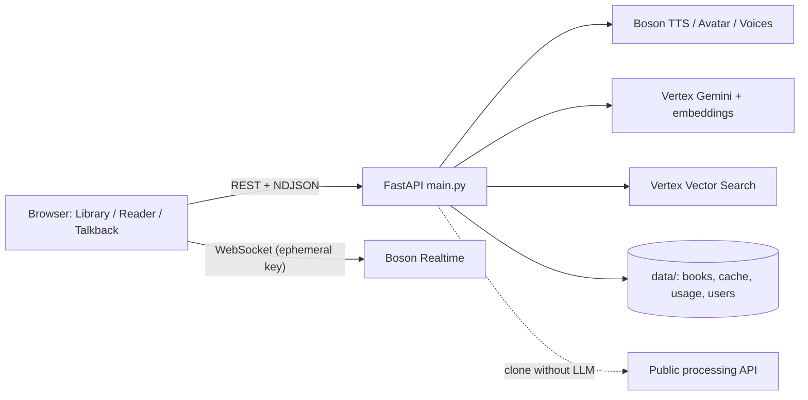
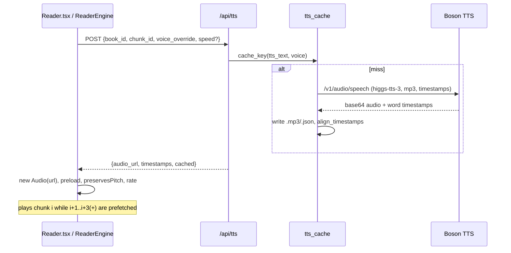
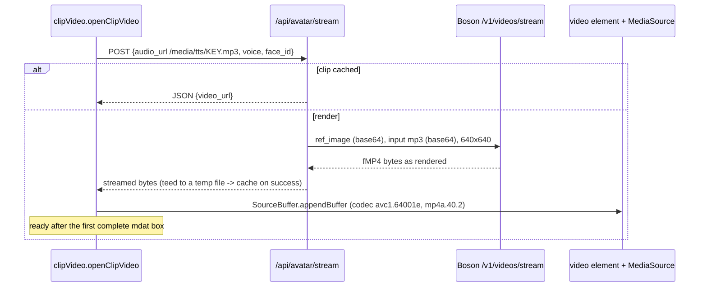
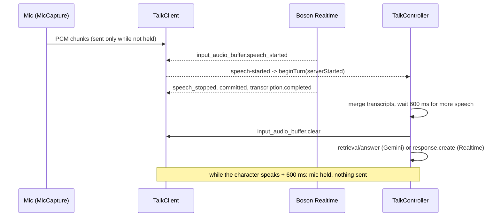
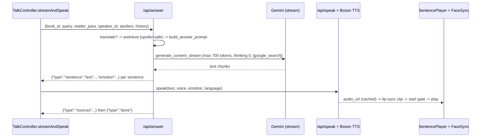
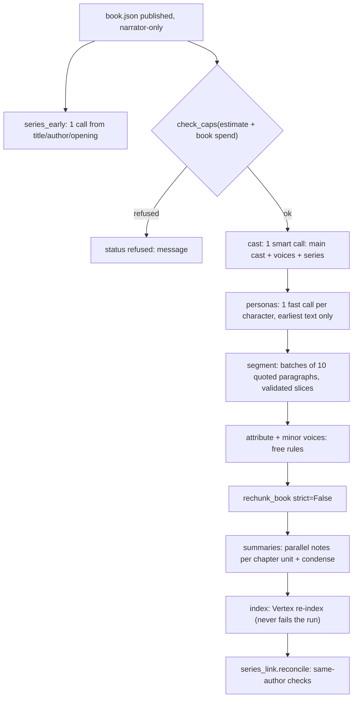

# Talkback: how every feature works

Written from the code at commit `7158c68` on `main` (backend `backend/app`, frontend `frontend/src`, `preprocess/`,
`scripts/`). Where `docs/internal/NOTES.md` disagrees with the code, this document follows the code and says so.
Paths are relative to the repository root. "Unconfirmed" marks anything that could not be verified from the code alone.
See also [ARCHITECTURE.md](ARCHITECTURE.md) (diagrams, APIs, configuration) and [FEATURES.md](FEATURES.md) (feature list
with status).

---

## 0. The big picture

Talkback has three parts:

1. **Backend** (`backend/app`, FastAPI, Python 3.12). It holds the books (`data/books/<id>/book.json`), parses
   uploads, calls Boson (TTS, Realtime keys, Avatar, voice cloning) and Google Vertex (Gemini, embeddings, Vector
   Search), and enforces the spoiler rule, caps and accounts. `app/main.py` is the API; `app/asgi.py` picks either the
   main app or the public processing API (`PUBLIC_API=true`).
2. **Frontend** (`frontend/src`, React + TypeScript, Vite). The Library page, the Reader page (read mode + Stage),
   and Talkback (the chat view). Audio playback, mic capture, the Realtime WebSocket, lip-sync video and tool calls
   all run in the browser.
3. **Offline tooling** (`preprocess/`, `scripts/`). Builds the shipped books (cast, segments, summaries, indexes),
   probes APIs, deploys, and reports spend. Uploads reuse the same core code at runtime (`app/enrich/*`).

External services and models:

| Service | Model / endpoint | Used for |
|---|---|---|
| Boson TTS | `higgs-tts-3`, `POST /v1/audio/speech`, mp3, `timestamps: true` (English) | read-aloud chunks, answer sentences, recaps, previews |
| Boson Realtime | `wss://api.boson.ai/v1/realtime?model=higgs-realtime`, STT `higgs-stt-3.1` | voice questions, Realtime answers, tool calls |
| Boson keys | `POST /v1/realtime/client_secrets` (TTL 600 s) | ephemeral browser key per connection |
| Boson Avatar | `higgs-avatar`, 640x640, `POST /v1/videos` (+poll) and `POST /v1/videos/stream` (fMP4) | lip-sync clips, talk/idle loops |
| Boson voices | `POST /v1/audio/voices`, `DELETE /v1/audio/voices/{id}` | voice cloning |
| Vertex Gemini | `GEMINI_MODEL` default `gemini-2.5-flash`; processing `ENRICH_GEMINI_MODEL` (deploy sets `gemini-2.5-flash-lite`) | answers, translation, upload enrichment, equations, face box, describe |
| Vertex embeddings | `gemini-embedding-001`, 768 dims | Vector Search index and queries |
| Vertex Vector Search 2.0 | REST `vectorsearch.googleapis.com/v1/.../dataObjects` | cloud retrieval (vector + text search) |
| Google Search grounding | `types.Tool(google_search=GoogleSearch())` on Gemini | web search on some answers |
| Local | `intfloat/multilingual-e5-small` (sentence-transformers), `rank_bm25` | local retrieval |

---

## 1. Library, uploads and duplicate detection

**What the user sees.** The Library has two shelves, Novels and Textbooks. Series are stacked into one card that
opens in place. "Add book" opens a dialog: drop one or more PDF/.txt files (20 MB each), Title (auto-filled), Author
(auto-filled), Kind (Auto-detect / Novel / Textbook). Each file gets its own job card: "Queued", "Reading the PDF…",
"Readable now · Indexing 300 / 1300", "Readable now · Splitting the dialogue by character", "Ready". A file already in
the library shows "This file is already in your library as “X”" with "Open the existing copy".

**Flow.**
1. `pages/Library.tsx:AddBook.submit` builds an `UploadRequest` (one entry per file; several files use the file name as
   title). `Library.startUploads` posts files one at a time with `api.uploadBook` (`POST /api/books/upload`, multipart
   `file,title,author,kind`).
2. Before FastAPI parses the body, `app/uploadlimit.py:UploadSizeLimit` refuses Transfer-Encoding (400), requires
   Content-Length (411), refuses > 20 MB + 1 MB slack (413) and counts real bytes as they arrive (a lying header still
   gets 413).
3. `main.upload_book`:
   - rate limit `upload_bucket` (6 per minute per account/IP);
   - `IngestGuard.acquire()`: at most `UPLOAD_QUEUE_MAX = 6` uploads in flight (accepted, not yet published); a hold
     older than 15 min whose task never started is taken over;
   - checks `.pdf`/`.txt`, size, `%PDF` magic;
   - **duplicate detection (#82)**: `ingest_upload.content_hash` = sha256 of the bytes. Key `(account ns, digest)`.
     `_hash_claims` (in memory) catches the same file being added right now (409 `reason: processing`);
     `ingest_upload.find_upload` reads the per-account `upload_hashes.json` (digest -> book id) and checks the book:
     `book.json` present -> 409 `reason: duplicate` with `book_id` and title; a `deleting.json` tombstone while a delete
     runs -> 409 `reason: deleting` (the client waits 5 s and retries, up to 60 times); a tombstone from a dead delete
     or a failed ingest does not block.
   - `make_book_dir(title)` creates `u-<slug>-<8 hex>` (ids never reused); `users.claim_book` writes `owner.txt`
     (PER_USER); the original file is saved to `data/uploads/<id>.<ext>`; the hash is recorded; status "Queued".
   - The background task `main._ingest` runs; the request returns 202 `{book_id}`.
4. The client polls `GET /api/books/{id}/status` (`api.pollUpload`, every 2 s, tolerates 3 failures and up to 60 s of
   a restarting backend) until `uploads.uploadSettled`: error, or ready with indexing and enrichment no longer running.
   A 429 ("already being processed" / "Too many uploads") makes the card wait 15 s and retry (up to 40 times).
5. `main._ingest` -> `_ingest_work` under `_ingest_slot` (`INGEST_CONCURRENCY = 2` parses at once): extract text,
   detect kind (section 3), `ingest_upload.process_upload` (parse + TTS chunks + retrieval chunks, sections 4, 5 and 11), then
   `publish_book` writes `book.json` (only now is the book listed: a half-processed upload is never visible).
6. Then, in order: equations job (textbook PDFs with math), early series detection (novels), Vertex indexing (vertex
   backend), enrichment planning (section 15).

**Failure handling.** Any ingest exception -> `discard_book` (keeps only status.json) and status `error` with a
readable message for `UploadError` ("Scanned (image-only) PDFs are not supported", "too many pages", …) or "The file
could not be processed." otherwise (no details leak). After a restart, a status still "processing" reads as
"Processing was interrupted; please upload again."

**Constants.** `MAX_UPLOAD_BYTES` 20 MB, `MAX_PAGES` 2000, `MAX_CHARS` 5,000,000, `MAX_PARAGRAPH_CHARS` 5000
(longer paragraphs are split at sentences, never inside an inline formula: `ingest_upload.split_spans`).

**Main files.** `pages/Library.tsx`, `uploads.ts`, `api.ts:uploadBook/pollUpload`, `main.py:upload_book/_ingest/_ingest_work`,
`ingest_upload.py:content_hash/find_upload/record_upload_hash/make_book_dir`, `uploadlimit.py`.

---

## 2. Auto title and author (#83, #95)

**What the user sees.** After choosing one file, "detecting title and author…" shows next to Title; the fields fill in
unless the user already typed in them.

**Flow.**
1. `Library.AddBook.pick` -> `detect(file)` -> `api.describeBook` (`POST /api/books/describe`; a .txt sends only its
   first 24,000 bytes).
2. `main.describe_upload`: `users.require_account` (PER_USER), per-caller `describe_bucket` 12/min, then
   `enrich/describe.py:describe`.
3. `describe._parse` runs `parts()` in a thread, at most `PARSE_CONCURRENCY = 2` files at once (else `Busy` -> 429
   "type the title for now"), timeout 10 s. PDF: pymupdf metadata title/author + text of the first 3 pages (≤ 6000
   chars). Text: Project Gutenberg `Title:` / `Author:` header + opening lines.
4. Junk metadata is discarded (`junk_title`: "Untitled", "Microsoft Word - …", file names; `junk_author`:
   "Administrator", "Adobe…"). Authors are split on `; / | newline and & ,` ("Austen, Jane" -> "Jane Austen") and
   joined with ", " (#95). A 4+ word author with no separator ("Christopher D. Manning Prabhakar Raghavan Hinrich
   Schütze") is "run together": the model is asked for the list.
5. If metadata gave both and is not run together -> `source: metadata`, no model call. Otherwise one fast-tier call
   (`Guess{title, authors[]}`, `max_tokens` 200), guarded by: `UPLOAD_ENRICH`, the upload total cap (estimate is
   reserved with `spend.add("describe", …)` before the call, overage added after), a global token bucket 20/min and a
   daily cap of 300 calls (in memory). A clone with no LLM uses the public service (`public_client.remote_llm("describe")`).
6. `uploads.autoFill` never overwrites a field the user touched.

**Costs.** About $0.0003 per call (Gemini Flash estimate in the code comment). Nothing is stored.

---

## 3. Novel vs textbook detection

**What the user sees.** With Kind = Auto-detect, the card ends with "Detected: Novel" or "Detected: Textbook"; any
upload can be moved later with "Move to Textbooks / Novels".

**Flow.** `main._ingest_work`: when `kind == "auto"`, `ingest_upload.extract_text` runs first, then
`enrich/detect.py:detect_kind(plain_text(raw))`:
1. **LLM** (when `UPLOAD_ENRICH` and spend allows, or the public service on a clone): `sample()` takes ~3000 chars
   from start/middle/end; one fast call returns `KindGuess{kind, confidence}`; cost is added to the upload spend.
2. **Heuristic** (`detect.heuristic`, always computed): over a 30k-char sample, positive score for textbook markers
   ("Figure", "Exercises", "theorem", "for example", …), numbered headings ("2.3 Title"), captions, numbered lists,
   "Chapter N … Learning objectives"; negative for quoted text share, said-verbs, personal-pronoun density.
   `score > 0.5` -> textbook (ties go to novel, "the richer, reversible experience").
3. If the model disagrees with a confident heuristic (`h_conf ≥ 0.7`) while itself under 0.7, the heuristic wins.
4. Any failure -> heuristic. Result stored as `Book.kind_detected {kind, confidence, method}`.

**Moving shelves** (`main.change_kind`, `POST /api/books/{id}/kind`, uploads only): textbook -> novel starts enrichment
unless characters exist; novel -> textbook **re-reads the original PDF as a textbook** (`ingest_upload.rebuild_textbook_text`
in a thread, outside the write lock) so equations, code listings and nested sections come back (figures do not yet, #148), applies it
under the book's write lock (`apply_textbook_text`; summaries are dropped because their paragraph numbers belong to
the old text), rebuilds the local index, deletes stale Vertex datapoints, re-indexes, restarts the equations job, and
writes textbook notes if needed. A kind change is refused (409) while any job runs (`_kind_claims`, `_enrich_jobs`,
`_equation_jobs`).

---

## 4. PDF and text parsing

### 4.1 Paragraphs, headers, chapters and sections

**Flow** (`ingest_upload.pdf_to_text`, then `parsing.parse`, then `ingest_upload.build_book`):
1. pymupdf `page.get_text("dict")` per page. Lines are regrouped into visual rows (`_assemble_rows`,
   `_attach_deco_rows`: a root/sum/hat glyph that pymupdf split into its own line is re-attached to its prose row).
2. Per line: cleaned text (ligatures, control codes), bbox, largest font size, bold, monospace.
3. Page furniture is dropped: first/last blocks repeated on ≥ 3 pages and ≥ 20 % of pages (digits normalized), bare
   page numbers, running headers "2.4 Title 39" (`_drop_running_headers`), table-of-contents pages and dot-leader lines.
4. Layout: two-column pages are reordered (left column then right, between full-width blocks); small-font text
   (< 0.85 × body size: footnotes, sidebars), captions and runs of numeric table cells are dropped (`_clean_layout`).
5. Headings (`_mark_headings`): a short block matching `HEADING_REGEX` ("Chapter 3", "PART II", "12 The Wedding",
   "2.3 Title"), or set ≥ 1.15 × body size, or bold and ≥ 1.05 ×. Four headings in a row = a TOC (dropped). A bare big
   "1" over "Boolean retrieval" becomes "1 Boolean retrieval"; "CHAPTER 8" joins the title after it. Front matter
   (©, ISBN, "University Press") is never a heading. Font-only headings get the `\x01` marker.
6. `merge_lines` joins lines into paragraphs unless the previous line ends a sentence **and** there is a paragraph
   signal: indent > 6 pt, vertical gap > 0.5 × line height, or a short last line (< 75 % of text width). It
   de-hyphenates "exam-" + "ple".
7. `parsing.parse` splits on blank lines into `Section`s and `Paragraph`s (Gutenberg `*** START OF` markers handled;
   curly quotes normalized, `_italics_` removed). Marker prefixes turn blocks into special paragraphs:
   `\x02` code, `\x03…\x04` display equation, `\x05…\x06` inline formula, `\x07` figure.
8. `build_book`: over-long paragraphs split (≤ 5000 chars); novels drop code/math/figure kinds (they are just text);
   textbooks get `Section.level` from the heading number ("2" = 1, "2.1" = 2, "2.1.1" = 3, max 4) so the reader shows a
   nested chapter list (`reader/ChapterList.tsx`, `chapterTree.ts`). `parsing.clean_title` strips stray glyphs and
   trailing page numbers. Then `rechunk_book` (section 5).

Plain .txt files go straight to `parse` (UTF-8, BOM stripped).

### 4.2 Code listings

`ingest_upload._code_score`: a block is code when ≥ 80 % of its characters are monospace, or (≥ 3 lines) when ≥ 2
lines and ≥ 40 % have assignment arrows (`←`, `≠`), or ≥ 40 % of lines are numbered and ≥ 60 % carry pseudocode
keywords (if/then/while/return…). A run of code blocks (plus a "NAME(args)" title) becomes one `\x02` paragraph of kind
`code`: shown in a code font (`para-code`), **spoken only as "Code listing skipped."** (`ttschunks.CODE_SPOKEN`), never
fed to retrieval topic search or quizzes.

### 4.3 Display equations (#41)

**What the user sees.** In a textbook, an equation appears typeset (KaTeX); before Gemini has read it, the cropped
picture from the PDF; if neither exists, the extracted text. The narrator says e.g. "Equation 3 point 4: y hat equals
beta zero hat plus …".

**Detection** (`_math_class`, `_mark_math`): each line is STRONG (≤ 2 prose words and a big operator, or math-font
letters (CMMI/CMSY/CMEX, STIX, Cambria Math, Symbol, …) with an operator or ≥ 3 of them), WEAK (short prose-free piece
≤ 24 chars: a limit, exponent, "(3.4)") or NOT_MATH. Candidate lines that share a row with prose are inline math
(stay in the sentence). Remaining STRONG/WEAK lines are clustered by vertical distance (≤ 0.6 line heights). A cluster
is an equation only if it contains a STRONG line, ≤ 60 pieces, ≤ 220 pt tall, and is **set off** (indented ≥ 12 % of
text width, or taller than 1.5 lines, or with more than normal leading above and below). Pseudocode blocks are
excluded. The cluster becomes one `\x03` line carrying page, bbox (clipped at neighbouring prose), a `garbled` flag
(lost glyphs, several rows, accents) and the equation number "(3.4)" moved to the end.

**Pipeline after publish** (`main._start_equations` -> `_equations_job`, only textbook PDFs with math):
1. `ingest_upload.render_equations`: pymupdf crop at 200 dpi, grayscale, pad 2 pt, max 4 MP, at most 1500 per book;
   text of other lines painted white inside the box (`_crop`). Saved to `data/books/<id>/equations/e<n>.png`; the
   picture URL (with `?v=<hash>` cache-buster) is written to book.json at once (the reader shows pictures immediately).
2. `ingest_upload.render_inline` does the same for inline formulas (pad 1 × 0.5 pt, `mask_prose` paints out words
   tucked inside a tall glyph's box); formulas with the same text and size share one picture; max 3000 per book.
3. `enrich/equations.py:transcribe`: Gemini only (pictures are image parts). `BATCH = 8` pictures per call, in
   parallel; each picture sent with its garbled extracted text (≤ 160 chars) as a hint. Schema `Readings{items:[{id,
   latex, spoken}]}`. Prompt: LaTeX for KaTeX without delimiters or equation numbers, `aligned` for several lines;
   spoken ≤ 35 words (display) or ≤ 15 (ids starting `m`, inline); empty for non-equations. `_clean` strips `$`,
   `\[…\]`, rejects LaTeX > 1500 chars, caps spoken at 240.
4. Caps: estimate first (`IMAGE_TOKENS` 260 + hint, 120 out tokens each, ×1.2 margin), refused above the per-book cap
   or the remaining total budget; inline formulas only send as many as fit (`fitting`); stop at 1.25 × per-book cap.
5. `ingest_upload.update_equations` writes `latex`/`spoken` under the book's write lock and **re-chunks only those
   paragraphs**, so the narrator now speaks the reading.

**Reader** (`reader/equation.ts`, `BookText.Equation`/`WithMath`): `equationView` = KaTeX `renderToString`
(`throwOnError`, `trust: false` so model LaTeX can never inject links/HTML, `maxExpand` 500; a refused command is
detected by a sentinel error colour) with the number added as `\tag{3.4}`, cached (500 entries); else the image sized to
its PDF width in ems (10 pt body); else text. Inline: text-style KaTeX, else picture sized by height, else the text.
The spoken word highlight covers a whole formula while any of its words is spoken (`equation.pieces`).

**Spoken form** (`ttschunks.equation_tts_text`): "Equation 3 point 4: <spoken>." when Gemini read it; else the
extracted text if not garbled; else just "Equation 3 point 4.". Inline formulas: `spoken_text` replaces the garbled
span with its reading (≤ 120 chars) inside the sentence, and the chunker measures the 280-char limit on the spoken
form (`_fit_pieces`). `tts_cache.align_timestamps` maps each spoken word of the reading back to the formula's
character span.

**Fallbacks.** No Gemini (no `GCP_PROJECT`): pictures only, or the public service on a clone
(`public_client.transcribe_equations`, section 21). A failed batch stays pictures. Never raises.

### 4.4 Figures (#40)

**What the user sees.** In an uploaded textbook, "Figure 1.3: The two parts of an inverted index" is shown as an image
with its caption, which is read aloud by default ("Read captions" toggle in the player bar).

**Flow** (`_take_figures`): figures are found from their **caption** ("Figure N…" set small or bold), not from images,
because many textbook figures are text plus rules. Everything between the caption and the nearest prose line above it
(else below) is the figure; prose = body-size line of ≥ 5 words spanning the document's text column. The region is
cropped at 150 dpi, longest side ≤ 2000 px, max 500 figures per book, saved as `figures/fig-N.png` and becomes a
`kind: "figure"` paragraph whose text is the caption. Two-column pages are skipped (caption dropped). A figure met
mid-sentence is placed after that paragraph. Served by `GET /api/books/{id}/figures/{name}` with the book's access
gate; `api.fetchFigure` fetches it with the access header into an object URL. Caption chunks carry `caption: true`
(`reader/position.flattenChunks`); with captions off `nextChunk` and prefetch skip them without changing chunk indexes
(saved positions stay valid).

---

## 5. TTS chunking (≤ 280 chars, sentence-aligned) and delivery tags

**What the user sees.** Each sentence (or group of short sentences) is a clickable span; the one being read is lit.

**Flow** (`ttschunks.chunk_paragraph`, called by `rechunk_book` for every paragraph):
1. Code -> one chunk "Code listing skipped."; math -> one chunk (section 4.3).
2. Segments: the paragraph's `segments` (speaker-tagged slices from enrichment) or one narrator segment.
   `delivery.apply_styles` adds rule-based whispering/shouting (keeps an LLM style unless a rule overrides).
3. Each segment is located in `p.text` (must tile the paragraph; a mismatch raises, and with `strict=False` the upload
   pipeline gives that paragraph to the narrator).
4. `_groups`: `sentence_spans` (linear regex; skips "Mr.", initials "J. Smith", ellipses, lowercase continuations
   like `"Well?" said he.`), sentences > 280 split at the last `, ; : —` after a third of the limit, else a space
   (`split_long`); then **greedy packing of whole sentences while the spoken text stays ≤ 280** (`MAX_CHARS`).
5. Each group becomes a `TtsChunk {id "p<idx>c<n>", speaker, voice, tts_text, char_start, char_end}`.
   `tts_text = build_tts_text(...)`: `[voice prosody tags][<|style:…|>][<|emotion:…|>][<|prosody:expressive_*|>][<|prosody:pause|long_pause|>]` +
   `normalize_for_tts(spoken)` (numbers, years "1998" -> "nineteen ninety-eight", section numbers "2.3" -> "2 point 3",
   spoken math) with an sfx tag inserted before onomatopoeia.

Why 280: a project invariant (Boson TTS chunk size, see `CLAUDE.md`). Why sentence-aligned: the reader resumes at chunk starts,
and word timestamps are per chunk.

Note: the limit is measured on the spoken text **before** `normalize_for_tts` and without tags, so a chunk with many
numbers can exceed 280 characters after normalization (feature E10 in [FEATURES.md](FEATURES.md) is marked partial for this).

### 5.1 Voice tags

A character's `voice_tags` (one of `""`, `<|prosody:pitch_low|>`, `pitch_high`, `speed_slow`, `speed_fast`) come from
the cast step. In the default two-voice mode the server drops them (`cast.tags_for` returns `""`) so the book really
uses two voices; `/api/tts` swaps the book's tag prefix for the cast's choice only when `tts_text` starts with it.

### 5.2 Expressive delivery rules (#73), all rule-based, no LLM (`app/delivery.py`)

- **Lead pauses** (`ttschunks.lead_pause`, only on a paragraph's first chunk): `long_pause` for the first paragraph of
  a section and right after a scene break; `pause` for a dialogue paragraph right after pure narration that ended a
  sentence.
- **Scene breaks** (`is_scene_break`): a ≤ 40-char paragraph of only `* # ~ • · ◆ ◇ §` (plus `= _ -` and spaces) with at
  least one mark; it gets no tag itself and triggers the next paragraph's `long_pause`.
- **Style** (`detect_style`): only character speech. A short speech tag (≤ 9 words) right after/before the quote with a
  whisper verb (whispered, hissed, breathed, muttered, murmured) or shout verb (shouted, yelled, bellowed, roared,
  screamed, thundered, bawled; not "roared with laughter"), not negated ("didn't shout"); both found = ambiguous = none.
  ≥ 90 % capitals with "!" = shouting unless the tag says whisper.
- **expressive_high / expressive_low** (`detect_expressive`): whispered -> `expressive_low`; all-caps shouting, or a
  line ending in "!" whose tag says shout/scream -> `expressive_high`. Not repeated if the voice tags already have one.
- **Sound effects** (`sfx_at`, only at the very start of a character's line, after the opening quote): laughter
  ("Ha ha", "Hee hee", "Ho ho"), sneeze ("Achoo", "Atishoo"), cough ("Ahem", "Cough!"), sniff ("Sniff!"); sigh, crying,
  humming and screaming need the adjacent speech tag to confirm it ("she sighed", "sobbed", "hummed", "screamed"; a
  lone "Aaah!" needs capitals or a scream tag). The tag is inserted, the book text never changes.
- **Singing** (#74, `sung_from`/`is_sing_lead_in`): a song is verse the story says is sung: a lead-in sentence that
  mentions sing/sang/chorus/lullaby/hum… and ends on ":" (or on "sing"/"sang"), without repeat/recite/read or a
  negation, followed by a quoted or verse-like paragraph (`verse_score` ≥ 2: capitalised small words mid-line), or an
  inline song after "…began to sing: “". Continues for up to 8 paragraphs while the quote stays open or the text reads
  as verse; ≤ 700 chars per paragraph; same chapter only. Sung chunks get `<|style:singing|>` (replacing
  whisper/shout, no sfx/expressive inside). Errs towards no tag ("a false singing on prose sounds terrible").

### 5.3 Chunk-rules versioning and auto-upgrade

`ttschunks.CHUNK_RULES_VERSION = 2` (1 = #73/#74, 2 = sneeze/humming #135); `Book.chunk_rules` stamps the version a
book was chunked with (missing = 0). `books.load_book` queues `_upgrade` on a single background thread when a book is
older (`AUTO_RECHUNK=true`), and `main._warm_up` queues every book at startup (`schedule_all_upgrades`). The upgrade
re-parses book.json fresh (never the shared cached object), re-chunks (keeping segment styles), and saves under the
book's write lock only if the file did not change since (stamp = mtime + size); a failure is logged and that file
version is not retried. Requests keep serving the old chunks until the new file lands. **Cost: zero API calls**; only
chunks whose `tts_text` changed get new audio, and only when played (the cache key includes the text).

### 5.4 Natural speed via prosody tags (#78)

**What the user sees.** A "Natural speed" toggle (remembered in localStorage `talkback.naturalSpeed`). Off: 0.75–1.5x
uses `playbackRate` with `preservesPitch`. On: at 0.75x, 1.25x, 1.5x the chunk is re-voiced by Boson with
`<|prosody:speed_slow|fast|very_fast|>` and played at 1.0x (`naturalSpeed.speedTagFor`, `rateFor`).

**Flow.** `ReaderEngine.setSpeed(speed, tag)` drops prefetched entries voiced with another tag (but keeps the playing
chunk and the one being started) and refetches only the window; `api.fetchTts(..., speed)` -> `/api/tts` ->
`delivery.apply_speed` puts the speed tag first and removes any other speed tag. Each tagged chunk is a separate
cache entry (a new Boson call the first time). `very_slow` exists in the backend but no UI speed maps to it. Demo mode
disables natural speed (pre-rendered audio only).

### 5.5 TTS cache keys and word timestamps

`tts_cache.cache_key = sha256(json([model "higgs-tts-3", tts_text, voice, "mp3", timestamps=True] + ([language,
has_timestamps] if not English)))`. English keeps its old key. Files: `data/cache/tts/<key>.mp3` + `<key>.json`
(aligned and raw timestamps), served publicly at `/media/tts/` (only TTS audio is public). Concurrent requests for one
key share one Boson call (`asyncio.Lock` per key). Because the key covers the final `tts_text` (tags, emotion, speed,
voice), any change in delivery, voice or speed gets new audio, and anything unchanged is free forever.

`/api/tts` (`main.tts`): resolves voice = `voice_override` (the browser's cast resolver) or `cast.voice_for` or the
chunk's voice; refuses unknown voices (stops cache-minting with arbitrary ids); cache misses consume `tts_bucket`
(120/min); `cached_only` (demo) returns 409 for un-rendered lines. Boson client: max 4 TTS calls at once
(`TTS_SEMAPHORE`), retries transient errors 4 times (Retry-After or 2^n × jitter, cap 30 s), never retries
`insufficient_quota` (402 to the client).

`align_timestamps`: Boson returns word timings for the spoken (normalized, tagged) text. Each paragraph word is
normalized the same way ("1888" -> several spoken pieces that all map to the same char span); each Boson word is
matched against the next 4 tokens, joining up to 3 tokens (prefix match for words > 3 letters); tag residue Boson
sometimes glues to words ("emotioncontemplationprosodypitchlowTo") is stripped (`delivery.strip_tag_residue`); an
unmatched word keeps the previous span so the highlight never jumps backwards. Result `[{start, end, char_start,
char_end}]` relative to the chunk.

---

## 6. Two-voice / one-voice narration and gender

**What the user sees.** The Character Control panel (button "Character Control" in the player bar and Talkback;
renamed from "Voices" in #164, component still `reader/VoiceLab.tsx`): for novels, One voice / Two voices (default Two), a
narrator pick (Male / Female voice), and two cards (male voice + face, female voice + face), plus a per-character
gender override list. Textbooks: one card (the Tutor/narrator).

**How voices are resolved** (same rule on both sides: `backend/app/cast.py` and `frontend/src/reader/castLogic.ts`):
- `gender_of(speaker)`: narrator (and everyone in one-voice mode) = `narrator_gender` (user pick, else the gender of
  the book's narrator preset); characters = user override, else `genders.character_genders`, else narrator's gender.
- `slot_voice(gender)`: the user's voice for that slot, else the narrator's own voice for its gender, else `jake` /
  `chloe`.
- Textbooks read from `narrator.voice` only.
- The old Full-cast mode ("cast") is read as "two" (#93); per-character assignments are kept but unused.

**Gender inference** (`app/genders.py`, free/offline, cached per loaded book): stand-in ids (`minor_m`/`minor_f`),
then the name (titles "Mrs."/"Uncle", nouns "Queen"/"barge woman", a first-name list), then pronouns after its
attributed lines (`attribute.infer_genders`: ≥ 3 and 85 % one way, per the module doc), then the gender of the preset
the cast step picked.

**Persistence.** Server: `PUT/GET /api/books/{id}/cast` -> `users.cast_json` (per account with PER_USER, else
`data/books/<id>/cast_settings.json`); deleted voices/faces fall back to Auto. Browser: `createCastSaver` sends only
the newest state; `ReaderEngine.setVoiceResolver` applies the change immediately (section 7). Talkback per-character
Voice/Avatar picks (#106) live in localStorage `talkback:talk:<bookId>`.

**Preview.** One fixed line per voice (`PREVIEW_LINE`) through `/api/speak`: only the first preview of a voice costs.

---

## 7. Read mode playback engine

**What the user sees.** Play/Pause (k), prev/next (←/→), speed 0.75–1.5 (`[`/`]`), a lit sentence with the spoken word
marked, auto-scroll (paused for 5 s after a manual scroll), the reader's face speaking, and the position remembered.

**Flow** (`reader/ReaderEngine.ts`):
1. `Reader.tsx` builds `FlatChunk[]` (`position.flattenChunks`: every paragraph's TTS chunks + paragraph index) and
   creates one `ReaderEngine` when the server has a Boson key (`health.boson_key_set`) and no access code is missing;
   otherwise a **silent preview** advances at ~15 chars/s.
2. `play()` -> `startChunk(i)`: `entry(i)` fetches TTS once per chunk (voice from the resolver), creates an `Audio`
   element per chunk (`preload="auto"`, `load()` at once, `preservesPitch = true`, rate from `rateFor`).
3. **Prefetch** (`reader/prefetch.ts:prefetchEnd`): at least `PREFETCH_BASE = 3` chunks ahead, extended up to
   `PREFETCH_MAX = 5` while the lookahead is under `PREFETCH_MIN_CHARS = 360` (~25 s of speech), across paragraphs
   and sections. Entries outside the window are dropped (audio paused, clips released); a seek cancels everything
   outside the new window. A failed prefetch is retried when its turn comes.
4. `handleEnded` chains to `nextChunk` (skipping captions if turned off); generation counter `gen` invalidates stale
   loads after seeks.
5. **Word highlighting**: `Reader.tsx` runs a `requestAnimationFrame` loop calling `engine.activeWord()` = the last
   timestamp whose `start ≤ audio.currentTime`; `BookText.Spoken` wraps that char range in `<mark class="word">`. No
   timestamps (non-English, or alignment failed) = the whole chunk is lit. Only the current chapter is in the DOM.
6. **Resume mid-sentence on a voice switch** (#37): `applyVoices` finds entries whose voice differs
   (`voiceSwitch.staleIndexes`), refetches only those, and restarts the current chunk with `resume: true`: the old voice
   keeps playing until the new audio is ready, then `voiceSwitch.resumeTime` continues at the same word index in the
   new audio.
7. Autoplay blocks (`NotAllowedError`) set a "tap to play" notice instead of an error.
8. Position is saved to localStorage `talkback:pos:<bookId>` on every index change (not in demo).
9. `readerPara = chunks[index].para` drives the spoiler limit everywhere (it never runs ahead of the chunk).

**Lip-sync in read mode** (#80/#92/#104/#105): see section 9. The engine opens each chunk's clip together with its
audio, and the next clip(s) as soon as the current voice starts.

**Costs.** Boson TTS ~$0.015 per 1,000 characters (`spend.ts RATES`), only for cache misses; the debug drawer
(`ui/DebugDrawer.tsx`, `?debug`) shows a running session estimate (`spend.ts SpendTracker`).

---

## 8. Faces: library, voice cloning, camera capture, auto-crop, any voice × any face

### 8.1 Face library

**What the user sees.** "Add face": upload PNG/JPEG/WebP or take a photo; a square crop box placed around the head and
shoulders; optional "Animate after upload (about $0.05, 1 to 2 min)".

- **Camera capture** (`reader/CameraCapture.tsx`, `audio/camera.ts`): `getUserMedia({video:{facingMode:"user"}})`,
  a frame is drawn to a canvas, centre-square, ≤ 1024 px, JPEG 0.9 (`squareJpeg`); clear error messages per
  `NotAllowedError`/`NotFoundError`/`NotReadableError`.
- **Gemini face auto-crop** (#109): `reader/FaceCropper.tsx` calls `api.detectFace` -> `POST /api/faces/detect`
  (per-caller bucket 12/min, accounts only) -> `face_detect.detect`: one Gemini call (image + prompt "the main
  person's face … top of the hair to the chin and ear to ear, as fractions"), structured JSON
  `{found,x,y,w,h}`, thinking off, interactive lane of the pacer. Guards: upload-budget reservation, global bucket
  20/min, 300/day. `clamp_box` clamps into the unit square and rescales a 0–1000 answer. `faceCrop.proposeCrop`: side =
  2.4 × face height, eyes at 40 % down the crop; no face -> centred, top-biased square. The user can drag/resize; the
  crop is encoded as `portrait.jpg` ≤ 1024 px.
- `POST /api/faces` (`faces.create_face`): magic-byte check, ≤ 5 MB, stored as `f<16 hex>.<ext>` in the caller's face
  folder with metadata in `faces.json`.
- **Animate** (`POST /api/faces/{id}/animate`, `faces.animate`): renders the **talk loop** (the face saying a fixed
  neutral line in its bound voice or "default", TTS + avatar render) and the **idle loop** (the face over 6 s of
  near-silent room tone; pure zeros can be rejected). Per-face lock (a double click waits and pays nothing), avatar
  bucket 12/min, ~$0.05.

### 8.2 Voice cloning (WAV conversion, consent)

**What the user sees.** "Add voice": a script to read, Record / upload a file, a name, a face to show (from the
library), and a mandatory consent box "This is my voice (and face), or I have permission to clone them."

**Flow.**
1. `reader/LabDialogs.tsx:AddVoiceForm` records with `MediaRecorder` (webm/ogg) or takes a file.
2. `audio/toWav.ts:toCloneAudio`: Boson accepts wav/mp3/flac (and opus/pcm per the comment), so anything else is decoded
   with Web Audio and re-encoded as mono PCM16 WAV (`encodeWav`).
3. `api.cloneVoice` -> `POST /api/voices/clone` (bucket 5/min). `voices.validate_clone_request`: `consent == "true"`
   (server-side, refused otherwise), transcript and name required, ≤ 10 MB, WAV ≥ 3 s. Face id checked **before** the paid
   call.
4. `boson.create_voice(ref_audio_b64, ref_text, description=name)` -> voice id saved in the caller's `voices.json`.
5. A linked face (`face_id`, #113) is bound by `faces.link_voice` (no copy, `linked: true`); an uploaded image creates a
   new face bound to the voice.
6. Delete (`DELETE /api/voices/{id}`): presets refused; Boson delete (404 = already gone); faces keep existing, only the
   link goes; casts using it fall back to Auto.

### 8.3 Any voice × any face (#113)

Lip-sync requests name the **face on screen** (`face_id`) and the cached audio of whatever voice spoke; the server
animates that face with that audio. So a cloned voice can drive any face and a preset voice can drive a cloned face.
Read mode: the face is the speaker's slot face, else the narrator's (`readLipSync.readFaceFor`). Talkback: the
per-character Avatar pick, else the reading face, else the face bound to the voice (`castLogic.talkFaceId`).

---

## 9. Boson avatar lip-sync

### 9.1 Render and stream (fMP4 via MSE)

- **Server** (`main.lipsync_stream`): only audio this server synthesised (`/media/tts/<64 hex>.mp3`) is accepted; face
  from the caller's library (`face_id`) or the voice's bound face. Cache key = `<tts key>-<sha256(face bytes)[:16]>`,
  file in the per-account lip-sync folder (`users.lipsync_dir`), served by `/media/avatar` (PER_USER: only your own).
  A per-key lock means one render per clip. `avatar_bucket` 12/min. Budget per stream: 150 s and 40 MB; transient
  Boson errors before the first byte are retried. The body is forwarded as it arrives and teed to
  `<key>.<rand>.stream.tmp`, renamed into the cache only if the stream completed.
- **Non-streaming fallback** (`main.lipsync`, `/api/avatar/talk`): `create_video` + poll every 1 s (timeout 120 s) +
  download, cached the same way. Used when `MediaSource.isTypeSupported(AVATAR_STREAM_MIME)` is false
  (`avatarStream.chooseLipSyncMode`).
- **Client** (`talk/avatarStream.ts:openAvatarStream`): POST, JSON = cached file URL; else a `MediaSource` + object URL,
  bytes queued and appended on `updateend`, `endOfStream()` at the end; `MdatScanner` parses top-level MP4 boxes and
  resolves "ready" at the first complete `mdat` (first playable fragment, ~0.79 s of video, ~1.5–3 s after the request
  per the comments). `release()` aborts the request and revokes the URL. 60 s ready timeout.

**Cost.** ~$0.09 per minute of video (`spend.ts`; `scripts/usage.py` uses $0.08), cached per (audio, face) forever.

### 9.2 faceSync drift controller

The voice (TTS mp3) is **the clock**; the muted video follows it and nothing ever pauses or seeks the voice
(`talk/faceSync.ts:FaceSync`, shared by read mode, Talkback answers and recaps).
- `AudioClock`: anchored when the voice starts, advanced by wall clock × playbackRate; raw `currentTime` only nudges it
  (blend 0.1) or re-anchors after a jump > 0.2 s.
- `DriftController` (`DEFAULT_DRIFT`): EMA of (video − voice) with α 0.3; dead-band 0.04 s with hysteresis (enter below
  0.75×, leave above 1.25×); outside it `playbackRate = voiceRate × (1 − 0.6 × drift)`, clamped to ±8 %; a drift
  > 0.3 s (both smoothed and raw) allows a "seek", at most once per 1 s.
- In FaceSync a "seek" is **not** a visible jump: the clip is hidden (talk loop shows) and rejoins by rendezvous.
- Video stalls (`waiting`) -> hide, retry after a backoff of 1 s doubling to 8 s.
- **Rendezvous rejoin**: only when ≥ 1 s is buffered ahead of the voice (never seek into unrendered MSE data, which the
  browser would clamp), seek to voice + 0.25 s, wait for `seeked`, then start the video with a timer at the moment the
  voice gets there; a slow seek doubles the lead (max 1 s); seek timeout 1.5 s.
- Pause/resume of the voice freezes/unfreezes the face; the voice's `ended` takes the face down at once (#104).
- Speed (#105): the clip plays at the voice's `playbackRate` × nudge, so 0.75–1.5x stays in step.
- Read mode's pre-rendered per-chunk clips (`/api/avatar/{chunk}`, rarely used) follow the same idea in
  `reader/clipFollow.ts` (seek lead 0.2 s doubling to 1.5 s, 100 ms tick).

### 9.3 Start gate

`talk/startGate.ts:gateVoiceOnClip`: the first word waits until the clip is joined and buffered enough to start
**together from 0**, bounded by a cap: `START_WAIT_MS = 6000` (Talkback answers), `READ_START_WAIT_MS = 6000` (first
chunk after Play), `READ_CHAIN_WAIT_MS = 3000` (between chunks). Buffer needed (`faceSync.startLeadFor`):
`min(duration, 0.7 s + 0.09 × duration)` at 1x; at other rates the share is `1 − 1/(1.1 × rate)` (Boson renders at
~1.0–1.1x real time). No clip (no face, render failed) opens the gate at once; a timeout lets the voice start and the
clip joins late by rendezvous. Read mode keeps clips opened ahead: at least 1, more while the speech before the next
unopened clip is < 4 s, at most 3 (`readLipSync.clipAheadFor`).

### 9.4 Fallback talk/idle loop with adaptive speech-level thresholds

When no lip-sync clip is in step, the face is the idle loop (or portrait) with the talk loop cross-faded in while
speech is audible (`reader/FaceView.tsx`). Layers are never swapped (no black flashes).
- Read mode (`ReadFace`): "speaking" comes from real loudness: `reader/audioLevel.ts:AudioLevelMeter` routes the chunk's
  `<audio>` through one `AnalyserNode` (fftSize 1024, RMS of ~23 ms); `reader/speechLevel.ts:stepSpeech` uses
  thresholds **relative to the voice's running peak**: open above max(0.003, 0.2 × peak) for 16 ms, close below
  max(0.0018, 0.1 × peak) for 100 ms, peak decays with a 4 s time constant (so quiet cloned voices and loud presets
  behave alike; the old fixed 0.02/0.012 lagged up to 430 ms per the comment). No talk loop: the still image pulses with
  loudness. No Web Audio: "speaking while playing". Reduced motion: still portrait.
- Talkback (`FaceView`): `speechGate.createPlayingGate` makes "speaking" true immediately on playback and false only
  after 220 ms, so the gap between prefetched sentences does not flash the idle face. Realtime answers (PCM through
  `RingPlayer`) have **no lip-sync clip**; they use this loop.
- The next chunk's reader loops are preloaded (`readFace.loopsToPreload`) so a speaker change starts on time.

---

## 10. Talkback: push-to-talk, typed, hands-free

### 10.1 State machine

`talk/TalkController.ts`: `reading -> listening -> transcribing -> retrieving -> answering -> resuming -> reading`
(+ `talk-idle` in the chat view). It talks to the network through a `TalkSession` (`TalkClient`) and to the book through
`ReaderControl`, so it is tested with fakes.

### 10.2 Push-to-talk

**What the user sees.** Hold Space or the mic button; the reader pauses; release; "Hearing what you said…",
"Checking the story so far…", then the answer; reading resumes 1.5 s later at the start of the interrupted sentence.

**Flow.**
1. `pttDown -> beginTurn`: remembers `resumeIndex = currentIndex()` (chunk start = sentence start) and whether the
   book was playing, pauses it, cancels any answer (barge-in), then in parallel: `session.interrupt()` (if a Realtime
   answer was active), `session.ensureOpen(voice)` and `session.startMic()`.
2. `TalkClient.ensureOpen` (idempotent: React StrictMode would open two sockets) -> `fetchRealtimeKey`
   (`POST /api/realtime/token`, 10/min, mints a 600 s ephemeral secret, never cached) -> WebSocket with subprotocols
   `["realtime", "bai-client-secret.<key>"]` -> `session.update` (`sessionConfig`: model higgs-realtime, short
   `SESSION_INSTRUCTIONS`, audio-only output, client function tools, PCM 24 kHz in/out, `turn_detection: null` for
   push-to-talk, transcription `higgs-stt-3.1`, `noise_reduction: near_field` for push-to-talk only, temperature 0.3),
   then the last chat turns of this character as text items (`seedHistory`). Close code 1013 before open = connection
   limit: retry after 1/2/4 s.
3. `audio/capture.ts:MicCapture`: `getUserMedia` with echo cancellation, noise suppression, auto gain, mono ->
   AudioWorklet -> resample to 24 kHz -> PCM16 -> base64 frames of ~100 ms -> `input_audio_buffer.append`. Audio captured
   while connecting or while a cancel is pending is held and sent in order.
4. `pttUp`: a press under 300 ms is a **tap** = play/pause toggle (in the chat view it only cancels). Otherwise
   `stopMic`, wait for the socket/cancel, `input_audio_buffer.commit`, wait up to 6 s for
   `conversation.item.input_audio_transcription.completed`. Empty -> toast "I didn't catch that. Try again." and back
   to reading.
5. `answerQuery` (section 12).
6. After the answer drains: `afterAnswer` -> `resuming` -> after 1.5 s `backToReading` -> `reader.resumeAt(resumeIndex)`
   (only if it was playing before and auto-resume is on, or a tool forced it).

### 10.3 Typed questions

`TalkbackView` form -> `useTalk.ask` -> `TalkController.ask`: same turn without the mic; on the Realtime path the
question is first added as a user text item (`userTextItem`, #97), because the per-response instructions carry the
passages, not the question.

### 10.4 Hands-free with Boson semantic_vad (#135)

**What the user sees.** "Hands-free (use headphones): on". The mic stays open: speak to ask, speak over the character
to interrupt, silence ends the question.

**Flow.**
1. `setHandsFree(true)`: server mode unless `?gate=local` / localStorage `talkback:gate=local`
   (`handsFree.localGateForcedHere`). `setServerTurns(true)` drops a push-to-talk socket (turn detection cannot change
   mid-session: live 400 error) and opens one with `turnDetection("semantic_vad")` = `{create_response: false,
   interrupt_response: false, threshold: 0.6, silence_duration_ms: 500}`, no near-field noise reduction (it started
   turns ~1 s late live). `setMonitor(true)` keeps the mic open.
   - `create_response: false`: the server detects, commits and transcribes but never answers, so every answer still goes
     through our retrieval (spoiler-safe). If a `session.updated` shows `create_response` not false, or the VAD type was
     not accepted, `refuseServerMode` tries `server_vad`, then falls back to manual turns + the local gate (`turn-mode`
     event). A `response.created` we did not ask for is cancelled and never played.
2. `speech_started` -> `onServerSpeech` -> `beginTurn(serverStarted=true)` (the server already has the audio).
   `speech_stopped` -> "transcribing" and a fail timer `failWaitMs = min(5 s, 2.5 s + turn/4)`. A transcript arms a
   600 ms merge window (`MERGE_MS`): speech restarting continues the same question; `mergeTranscript` replaces a
   transcript that repeats the earlier one (the server re-transcribes the whole buffer) or appends new words.
3. `finishSrv`: **`input_audio_buffer.clear` every turn** (live probe: with `create_response:false` the server never
   clears the buffer, every committed turn reused one item id and was transcribed with all audio since the session
   start). Also cleared on a commit outside a turn (echo/noise) and when a half-heard turn is abandoned.
   - Empty transcript with < 400 ms of local speech (`MIN_TURN_MS`) = click/breath: dropped silently, items deleted.
   - Real empty turn -> "I didn't catch that. Try again." After 2 in a row (`EMPTY_TURNS_FALLBACK`): "I didn't catch
     that. Hands-free now uses the local voice gate." (`fallBackToLocal`). A failure also clears a language hint (a
     wrong hint gives no transcript at all, live).
4. **Echo hold**: `updateMicHold` holds the mic (`TalkClient.setMicHold`: chunks kept in a 1.5 s ring, nothing sent)
   while the character speaks and `MIC_HOLD_TAIL_MS = 600` ms after playback ends. A `speech_started` while held is
   ignored as echo.
5. **Barge-in** (server mode): while held, the **local strict gate** decides: `HANDS_FREE_OVER_SPEECH` = threshold
   0.04 RMS, 250 ms sustained, with the threshold raised to `ECHO_RATIO (1) × median echo level`
   (`createEchoFloor`: median of mic readings during the last 2 s of playback; the first 300 ms all count, later only
   readings under the bar so the reader's own voice never raises it). On "start": cut the answer, release the hold with
   a pre-roll of `minSpeechMs + 50` = 300 ms of held audio so the first words survive, and wait up to 2.5 s
   (`BARGE_CONFIRM_MS`) for the server's `speech_started`; if it never comes the turn ends quietly.
6. Pre-roll elsewhere (`TalkClient`): local-gate turns send the last 1.5 s (`PREROLL_MS`), a barge-in over speech 0.5 s
   (`BARGE_PREROLL_MS`), a press 0.3 s (`PRESS_PREROLL_MS`); server mode holds up to 3 s of audio while the socket is not
   open (`STREAM_HOLD_MS`).
7. **Auto fallback to the local gate** (`createVoiceGate(HANDS_FREE)`: 0.04 RMS for 150 ms starts, 700 ms of silence
   ends): used when forced, when the server mode is refused, or after 2 empty turns. While the character speaks (and
   300 ms after, `ECHO_TAIL_MS`) it uses the strict echo-relative profile. If the session closed on idle, speech
   detected by the idle gate reopens it and the held audio goes first.

Note: NOTES.md (2026-10-23) describes the strict gate as 0.10 RMS and 2.5× echo; the code ships 0.04 and 1×
(the old values are commented out in `talk/handsFree.ts`). `TalkClient.ts`'s PREROLL comment still says 400 ms.

### 10.5 Response-id binding, barge-in and voice-timed captions

- **Response binding** (`TalkClient`): `currentResponseId` is set on our `response.created`; audio/caption/done events
  of any other or cancelled id are dropped (`stale`); a cancel issued before `response.created` arrived
  (`cancelUncreated`) cancels that response when it shows up. `dropOutput` discards the cut-off answer's late deltas
  (the server generates faster than real time) until the next `response.created`.
- **Interrupt** (`TalkClient.interrupt`): flush local playback (`RingPlayer.flush` returns ms actually played),
  `conversation.item.truncate` at that position, `response.cancel`, wait ≤ 2 s for `response.done` (or
  `response_not_active`); mic audio and the commit wait until then; an unacknowledged cancel fails the turn ("The
  character could not be stopped").
- **Voice-timed captions**: Boson sends `response.output_audio_transcript.length` with `length_ms` per fragment (about a
  sentence). `captionAt` reveals every started fragment plus the current one word by word in proportion to its duration,
  ticked every 100 ms from `RingPlayer.playedMs()`; the full caption lands when playback drains. On a cut, the `heard`
  event carries the words actually played, and `chatLog.cutHeard` trims the stored reply so the memory matches what
  was heard; `[the reader interrupted here]` is appended to it in the history.

### 10.6 "Didn't catch that" timing summary

| Path | Wait before the message |
|---|---|
| Push-to-talk / local gate | up to `transcriptTimeoutMs` 6 s after the commit (#141: long questions take time) |
| Server turn (semantic_vad) | `failWaitMs = min(5000, 2500 + turnMs/4)` after speech stopped |
| Transcription `.failed` event | immediately (empty transcript) |

---

## 11. Retrieval: spoiler-safe search

**Invariant** (CLAUDE.md, `retrieval.py` header): for a novel read spoiler-safe, a passage is eligible only if
`para_end <= reader_para`, and the "story so far" summary only if `upto_para <= reader_para`. Enforced on the server,
never trusted to the client or the model.

**Flow** (`main.retrieve` / `main.answer` -> `retrieval.aretrieve`):
1. `_resolve_talk`: 404 for unknown/hidden books and speakers; `reader_para` clamped to the book; a minor character
   (`main=False`) is refused (403); a novel character whose `first_para > reader_para` is refused (403, "has not
   appeared yet") unless spoilers are on.
2. `multilingual.search_query` translates a non-English question to English for search (section 12.4).
3. `_clamp`: `spoiler_safe = kind == "novel" and not spoilers`. Textbooks and spoilers-on novels search the whole book.
4. Index (`main._index_for`, LRU 8):
   - **Local** (`RETRIEVAL_BACKEND=local`): `retrieval.Index` = BM25 (`rank_bm25.BM25Okapi` over `context_blurb + text`)
     plus, when `index/embeddings.npy` exists, multilingual-e5-small cosine: `score = 0.6 × cosine + 0.4 × min-max BM25`.
     Eligible chunks get +0.05 when within 15 paragraphs of the reader (`RECENCY_BOOST`). Top k returned in book order.
     With the optional `embed` extra, a background job builds e5 embeddings locally (uploads after publishing; built-in
     books and older uploads at startup), saved as `index/embeddings.npy` (gitignored); without it, a local run is
     BM25-only.
   - **Vertex** (`RETRIEVAL_BACKEND=vertex`, when the book's index state is "done"): `gcp/vertex_index.VertexIndex.asearch`
     runs text search (started first, needs no embedding) and vector search (`gemini-embedding-001` RETRIEVAL_QUERY) in
     parallel with the same `spoiler_filter` (`book_id == X and para_end <= reader_para`, or `$in` earlier series
     books), 4k candidates each, fused with **RRF** (k = 60) keyed by book+chunk, then **post-filtered again in code**
     ("never trust the store"). While the index is building or failed, BM25 on the same eligibility.
5. `_finish`: backstop filter (`is_eligible`), adds the **recent passage** (last 2 paragraphs up to `reader_para`) if not
   covered, sorts (earlier books first), then drops passages furthest from the reader until the text is under the cap
   (never the recent one), trims a single oversized one. Story so far: `latest_summary(upto_para <= reader_para)`,
   prefixed with "Earlier books:" (each earlier volume's closing summary, ≤ 160 words cut at a sentence) for series;
   full-book mode uses the book's last summary + earlier books.

**Series context** (`books.earlier_in_series`): books with the same `series` and lower `series_index` **in the same
library** (built-ins with built-ins; an upload only with uploads of the same owner, `books.same_library`) are fully
eligible: the reader has finished them.

**Chunks** (`retrieval.make_chunks`): paragraph-aligned, target 1400 chars, closes after ≥ 900 when the next paragraph
would pass 1400, never > 2000 unless one paragraph is longer, ~250 chars of overlap (≥ one paragraph).

**Budgets.** Gemini answers: k = 8, 12,000 chars of passages. Realtime instructions: k = 4, 4,500 chars (instructions
must stay short; capped at 8,000 chars).

---

## 12. Answer generation

### 12.1 Realtime vs Gemini answer paths

`main.answer_backend()` -> `/api/health.answer_backend`, read by `useTalk.answersViaGemini`:
- `ANSWER_BACKEND` explicit; else `vertex` retrieval -> **gemini**; local retrieval -> **realtime**; a clone with the
  public service reachable -> **gemini** (answers written by the service).
- **Realtime path, text mode (the default, B1)**: `/api/retrieve` (`text_answer: true`) returns `instructions`
  (persona + rules + story so far + passages + the chat so far + the spoken-output and `[feeling]` marker rule, the
  same `ANSWER_SUFFIX` Gemini gets) -> `TalkClient.respond` sends `response.create {instructions, input: [the
  question], max_output_tokens: 600}` to a session opened with `output_modalities: ["text"]` -> the answer arrives as
  `response.output_text.delta`; `talk/sentences.ts` splits it into sentences as it streams, `talk/emotionMarker.ts`
  strips the marker (the port of `emotion.split_marker`), and each sentence goes through the same `sentencePlayer`
  as a Gemini answer: `/api/speak` with the emotion tag in the speaker's voice, a lip-sync clip on the face shown,
  the start gate and face sync. Captions, memory (the bubble text), barge-in (`heard` = the sentences whose sound had
  started), pause/resume, quiz mode, function tools and hands-free all work as before. Live (2026-10-24 probe) the
  text comes almost at once (0.12 s to the first delta, 0.30 s to the whole answer); the first sentence's TTS takes
  about 2.5 s, so time to first audio is about 2.8 s against 0.6 s for direct audio (the lip-sync start gate adds its
  own wait, as on the Gemini path).
- **Realtime path, direct audio (`?answers=audio`, or localStorage `talkback:answers=audio`)**: the old path for a
  comparison: `output_modalities: ["audio"]`, Boson speaks the answer itself (PCM 24 kHz into `RingPlayer`), no
  emotion tags and no lip-sync (the face uses its talk loop). `talk/answerMode.ts`.
- **Gemini path**: `/api/answer` streams NDJSON sentences; the browser speaks each with Boson TTS (`/api/speak`) and
  lip-syncs it. No Realtime function calls: commands go through `parseIntent` (section 13).

Live finding behind both Realtime modes (probes `scripts/probe_realtime_text*.py`, 2026-10-24, `higgs-realtime`): when
`response.create` carries per-response `instructions`, the model does not see the conversation's items: not a user
text item, not the committed audio turn, not seeded history, not a `function_call_output`. Only `response.input` reaches
it (a bare `response.create` without instructions does see the items), and a note appended to the instructions is not
acted on either. So the question (typed, or the transcript of what was said) always travels as `response.input`, the
chat history is written into the instructions by `/api/retrieve`, and a tool continuation carries the tool results as a
`user` input message (`TalkClient.returnTools`; a `system` role is refused with "Invalid role"). Until this change the
Realtime path answered from the retrieved passages without seeing the question itself, and a tool continuation never
saw the tool's result.

`GeminiAnswerer.stream_sentences` (`gcp/llm.py`): `max_output_tokens` 700, `thinking_budget` 0 (retried without it
for models that reject it), sentences split at `. ! ? 。！？` + whitespace, interactive lane of the pacer with
retries **only before the first token** (a stream that broke mid-answer is not replayed). The browser shows a toast if
no sentence arrives within 15 s (`firstSentenceTimeoutMs`) and speaks sentences in order while prefetching the next 3
(`PREFETCH_DEPTH`); usage is logged with grounded/sources flags.

### 12.2 Personas and prompts (`app/personas.py`)

- Templates: `CHARACTER_TEMPLATE` (speak as Name: persona; persona describes manner only, knowledge comes only from the
  notes; keep secrets; 2–4 spoken sentences, specific; never invent; earlier books known in full, this book only up to
  the reader; famous story but use ONLY the notes; decline future questions with no hints; never state or deny an
  outcome the notes do not establish; reply in the reader's language), `NOVEL_NARRATOR_TEMPLATE`, the "FULL" versions
  for spoilers on, and `NARRATOR_TEMPLATE` for textbooks (a warm documentary-style tutor, 2–5 sentences, no formulas
  read symbol by symbol). `READER_TONE_RULE`: react to the reader's mood. Passages formatted as `[Book, ¶12-15] text`.
- Personas come from the cast step (section 15.1): one cheap call per character written **only from the paragraphs
  around its first appearance** (`first_para − 5 … first_para + 40`), about manner (speech habits, quoted phrases), never
  plot facts. Fallback "X speaks in their own way."
- Gemini prompt = instructions (≤ 24,000 chars minus suffix) + optional `WEB_SEARCH_RULE` + `ANSWER_SUFFIX` (spoken
  word-for-word output + the emotion rule). The language rule is put **first** so the length cap never cuts it.

### 12.3 History: last 6 turns per character, per-character sessions

- `chatLog.priorTurns(messages, speakerId, 6)`: finished user/character turns **with that speaker only**, each ≤ 500
  chars, interrupted replies marked, narrator recaps and the turn in progress left out. Sent as `history` to
  `/api/answer` (backend accepts ≤ 8, `MAX_HISTORY_TURNS = 8`) and put in the user message as "The conversation so far
  (… not a source of story facts)"; the system prompt built from `reader_para` stays the only fact source.
- Realtime: `historyProvider` seeds a new session with that character's turns; `useTalk.resetIfSpeakerChanged` drops the
  socket after a speaker switch once no answer is in progress, so each character's session holds only its own chat.
- Chat is kept per book in memory + sessionStorage (`talkback:chat:<bookId>`, ≤ 50 messages); "Clear" also resets the
  Realtime conversation.

### 12.4 Language rule and translated search (#12)

`multilingual.detect_language`: a non-Latin script, or ≥ 2 stopwords of a language that outnumber English ones.
`foreign_language` -> `LANGUAGE_RULE` ("Answer only in Spanish … translate the notes, keep names as the book has them").
Search uses an English translation: Gemini, temperature 0, ≤ 200 tokens, interactive lane, 2 attempts × 0.3 s, **4 s
timeout** (the answer waits for it), LRU cache of 256; a clone uses the public service (3.5 s). Any failure searches
the original question (the multilingual e5 embeddings still partly match). Browser side (`talk/language.ts`):
a badge ("Español"); a clear language in the two newest of the last three questions sets the Realtime transcription
hint (ISO 639-1); the newest clear question sets the TTS answer language (ISO 639-3, `/api/speak language`), which
Boson voices **without word timestamps** (only English has them in this code) and with normalization on; that sentence
gets its own cache key.

### 12.5 Emotion markers -> TTS emotion tags (#14)

Gemini is told to start every sentence with `[feeling]` from the 20 Boson emotions (or `[neutral]`).
`emotion.split_marker` strips leading markers in many shapes (`[sadness]`, `[Emotion: fear]`, full-width brackets,
`<|emotion:fear|>`, an unclosed `[sadness I…`) and stray inner markers; only a valid emotion is kept. The NDJSON line
carries `emotion`; `answerEmotion.createEmotionMemo` remembers it per sentence text; `/api/speak` re-validates it and
sends `<|emotion:X|>text` to Boson (`emotion.tts_input`), stripping any other Boson tag from the text first
(`emotion.strip_tags`, a user/model can never inject tags). The public service's sentences are re-parsed on the clone
(not trusted).

### 12.6 Google Search grounding

- **When**: `websearch.allowed(kind, spoilers)`: textbooks always; novels **only with spoilers on**; never with
  `WEB_SEARCH=false`. A spoiler-safe novel never gets the tool (the web would reveal later events).
- **Realtime path (B2)**: the same rule picks Boson's server-side `{"type": "web_search"}` tool
  (`talk/webSearch.ts sessionTools`, rebuilt before every turn so the spoilers switch is honoured at once; the open
  web, no `allowed_domains`). The server runs the search itself: the response ends with a `function_call` item
  (`name: "web_search"`, `executor: "server"`) right after the model's own preamble ("Let me dig that up"), the
  result arrives as a `function_call_output` item (`conversation.item.added`), and the server starts the answer
  response on its own. `TalkClient` therefore does **not** treat such a response as a finished turn (no
  `response-done`, no auto-resume: the latent bug #4 of the research notes), never sends `response.create` or a
  `function_call_output` for it, expects the server-started `response.created`, shows "Searching the web…" in the
  chat meanwhile, and reads the links out of the result item ("[n] Title / URL / excerpt" blocks, a format the docs
  call unstable) into the reply's source links. A barge-in during the search cancels the answer the server then starts.
  Live (2026-10-24): preamble at 0.8 s, result at 1.3 s, the server's answer at 1.8 s, with three sources.
- **Cap**: `take_local()` spends one of `GROUNDED_DAILY_CAP` (default 100 per UTC day, persisted in
  `data/usage/grounded_answers.json`); past it, a normal answer. Deploy sets 100,000.
- **Call**: `tools=[GoogleSearch()]`; if the grounded request is refused before streaming, it retries once without the
  tool. Sources come from `grounding_metadata.grounding_chunks[].web` (cleaned: http(s) only, no whitespace, dedup,
  ≤ 5, titles ≤ 120); Google's Search Suggestions HTML (`search_entry_point.rendered_content`, ≤ 32 KB) passed
  **unmodified** as Google's terms require.
- **Display** (`reader/SourceLinks.tsx`): links under the reply (never spoken: the prompt forbids reading URLs) and the
  suggestions in `<iframe srcdoc sandbox="allow-popups allow-popups-to-escape-sandbox" referrerpolicy="no-referrer">`,
  fixed 64 px height, `<base target="_blank">`.
- **Cost**: 1,500 free grounded prompts/day on 2.5 Flash, then $35 per 1,000 grounded prompts (NOTES; billed only when
  sources come back).

---

## 13. Voice agent tools and parseIntent fast paths

**What the user sees.** "Read chapter 3", "go back a bit", "where is tf-idf explained?", "quiz me on this section",
"explain this equation", "summarize chapter 4", "slower", "bookmark this", "use two voices". A chip appears in the chat
("Jumped to Chapter 3") and the character confirms in a sentence.

**Two routes to the same `runTool`** (`talk/tools.ts`, run in the browser against the reader through `Reader.tsx`
`toolDeps` refs):
- **Realtime**: the tools are declared in `session.update` (`toolDefsFor(kind)`: `TOOL_DEFS` for novels,
  `TEXTBOOK_TOOL_DEFS` for textbooks). The model emits `function_call` items; `TalkClient.clientCalls` collects them at
  `response.done`; `TalkController.onToolCalls` runs them, `returnTools` sends `function_call_output` + a new
  `response.create` with the same instructions; a fresh 15 s watchdog guards the continuation.
- **Gemini** (no function calling): `parseIntent(text)` matches a small set of plain phrasings after stripping
  "okay / can you / please" and punctuation (transcripts are prose). Anything else is a question. Refused commands show
  a toast; quiz/explain return an `ask` text that Gemini answers aloud.

**Novel tools**: `jump_to` (chapter number, roman numeral, words, "last", quoted passage, or bookmark), `read_chapter`,
`resume_reading`, `pause_reading`, `set_voice_mode`, `set_narrator`, `set_speed` (snaps to 0.75/1/1.25/1.5,
faster/slower/normal), `open_recap` (chapter/book/series or a named chapter), `bookmark` (localStorage, last 20),
`show_cast` (opens the Character Control panel; lists only characters met unless spoilers on), `go_back`.

**Spoiler gate** (novels, spoilers off): `resolveJump` refuses any place past `readerPara`, and re-checks the chunk it
lands on; a quoted passage takes the nearest match at or before the reader ("only appears later … spoilers are off"
otherwise); `next_section`, `find_topic`, `quiz_me`, `explain_here` (looks only back) and `open_recap` apply the same
limit.

**Textbook tools** (no spoiler limit, one tutor voice): `jump_to`/`read_chapter` by section number at any depth
("2.3", "two point three", "go to 4.1"), title words, or topic; `next_section`/`previous_section` (section or chapter);
`go_back` (paragraphs or sentences, ≤ 50); `find_topic` (`sections.findTopic`: exact title match first, else a local
tf-idf search with a plural stemmer over non-code paragraphs, needing half the query words, phrase bonus, title bonus);
`quiz_me` (section text ≤ 3000 chars, equations as LaTeX + spoken form, figures as captions; pauses reading);
`explain_here` (current paragraph, or the nearest equation/figure within 6 paragraphs back or 2 ahead);
`resume/pause`, `set_speed`, `open_recap`, `bookmark`.

**Quiz mode across turns**: `quiz_me` returns a `quiz {title, text}`; `TalkController.quiz` holds it. Each next turn:
Realtime appends `quizTurnInstructions` (grade question n of 3, then ask n+1, or give the score); Gemini sends
`quizGeminiQuery` (≤ 500 chars, the earlier turns are in history). An answer counts only when it completes (a cut-off
answer is asked again). Ends after 3 answers, on "stop/cancel/enough", any other command, reading resuming, a speaker
change, or leaving Talkback.

**Summarize chapter**: `open_recap` with `chapter` resolves the section (textbook: any; novel: only reached chapters)
and calls `Reader.recap({scope:"chapter", section})` -> the narrator posts and reads the recap (section 14); the model is
told not to summarize it itself.

How tools affect resuming: `moveTo` sets where reading continues; `play` forces resume after the answer
(`read_chapter`, `resume_reading`, `go_back`); `pause` prevents it. A tool that asks reading to go on also switches
Talkback back to the page (`Reader.tsx resumeAt`).

---

## 14. Recap

**What the user sees.** A Recap menu (player bar / Talkback): "Last chapter" (textbook: "This chapter"), "This book so
far", "The series so far" (series only), or a named chapter. With voice available, the narrator posts the recap into
the Talkback chat and reads it aloud on the narrator's face (lip-synced); without it, a text panel.

**Flow.** `Reader.recap` -> `useTalk.narrate(label, load)` -> `api.fetchScopedRecap` (`GET /api/books/{id}/recap?para=&scope=&section=`)
-> `recap.scoped`. **No model call**; built only from stored summaries.
- Novel chapter: the last finished chapter (or this one in chapter 1): the latest summary with `upto_para` in that
  chapter and ≤ `reader_para`; the part after "The current chapter so far:" (upload notes carry that mark); for
  older rolling notes, the sentences whose content words were < 60 % in the previous note (`new_sentences`).
- Novel book: the latest summary `upto_para ≤ para`. Series: earlier books' closing summaries + "This book so far".
- A named novel chapter: only as far as the reader has read.
- Textbook (notes tagged with `section_id`): any chapter/subsection on request, wherever the reader is (no spoilers);
  "book" = each chapter's first 2 sentences, most recent chapters first, within 300 words.
- **Voice recap**: `readAloud.createReadAloud` splits the text into parts ≤ 380 chars (`/api/speak` takes ≤ 400),
  synthesises 2 parts ahead (prefetching all of them queued behind the server's 4 TTS slots and timed out), lip-syncs
  each part, and supports pause/resume mid-part (#88; up to 3 paused texts keep their clip). Recaps are never sent to
  the model and are left out of chat memory.

The legacy "Previously…" endpoint (no `scope`) returns the latest summary, the chapter title and earlier-books recaps.

---

## 15. Upload enrichment pipeline

**What the user sees.** The book is readable with the narrator immediately; the card then shows "Finding the main
characters" -> "Splitting the dialogue by character" -> "Giving untagged lines to their speakers" -> "Writing chapter
notes for the recap" -> "Making the book searchable" with a progress bar; voices, character talk and recap switch on as
each stage lands.

**Planning** (`main._plan_enrichment` -> `_decide_enrichment`): `enrich_pipeline.estimate_for(book)` (from text length,
×1.15 margin, includes 5 series checks) and `check_caps(estimate, book_id)`: refuse when estimate + **what this book
already cost** > `UPLOAD_BOOK_CAP_USD` (default $4) or total spend + estimate > `UPLOAD_TOTAL_CAP_USD` (default $15)
-> status `refused` with a plain message. `UPLOAD_CONFIRM=true` (testing mode) waits with `awaiting_confirmation` and
the estimate ("Process with characters (~$0.12)"). Otherwise `running/queued`.

**Run** (`main._run_enrichment` under `_enrich_lock` = `ENRICH_PARALLEL` (1000) jobs at once; never two jobs per book):
textbooks -> recap notes only (section 15.6); a novel with characters and summaries is "done" without paying.
`enrich_pipeline.enrich_book` -> `run_stages` with a save (checkpoint) after every stage:

### 15.1 Cast + series in one call (`enrich/cast.py:cast_novel`)
- Input: `Title "X" by Y` + numbered paragraphs `[0] …`; a book over 300,000 chars (~85k tokens) is sampled as evenly
  spread blocks of 12 paragraphs (`numbered_sample`).
- One **smart-tier** call, schema `MainCast{characters[≤8]{id, name, aliases, first_para, gender, voice (6 presets),
  voice_tags}, narrator_voice, narrator_is_character, series, series_index}`, effort medium, 4000 tokens. Prompt rules:
  only speaking/plot-relevant characters by importance, voices by gender/age/temperament, tags to separate shared
  voices, first-person narrator as a character with the same voice, series by its common short name ("Dune", volume 1
  counts).
- `apply_cast`: `first_para` is **recomputed from the text** (first paragraph matching any alias > 2 letters), because
  the spoiler gate depends on it; the model's guess is only a fallback. Characters marked `main=True`.
- `apply_series`: slug via `series_slug` ("The Dune Chronicles series" -> "dune-chronicles"), index 1–99; an existing
  series (early detection) is kept.
- A first-person narrator triggers a rechunk (narration in that character's voice).
- No LLM at all (no credentials) -> `fallback_cast`: names that appear ≥ 2 times next to speech verbs, voices handed out
  in turn, status "done" with a degraded note.

### 15.2 Personas: see section 12.2. Run concurrently (`tasks.gather_or_cancel`: the first exception cancels siblings).

### 15.3 Segmentation + validation as slices (`enrich/segment.py`)
- Only paragraphs containing `"` (text is normalized to straight quotes) and only if the book has main characters.
- `BATCH = 10` paragraphs per fast-tier call with the cast list and 2 previous paragraphs of context; schema
  `BatchResult{paragraphs[{para, segments[{speaker, text, emotion?, style?}]}]}`.
- `validate_segments` requires the segment texts to **tile the paragraph exactly** (whitespace aside), in order, with
  known speakers (others -> narrator). Missing quote marks (Gemini often drops them) are restored from the paragraph:
  every final segment is a **slice of the paragraph text**, then checked with `tiles()` the way the chunker reads it.
- A paragraph whose batch answer fails: retried alone once (`segment_paragraph`), then narrator. A failed batch: narrator.
  Counts `skipped/llm/retry/fallback` are logged.

### 15.4 Attribution and minor voices (free, offline)
`enrich/attribute.py`: untagged back-and-forth lines get a speaker from a nearby tag ("said Ron"), paragraph continuity,
or two-person alternation (vetoed by a vocative); ambiguous ones stay with the narrator. With `MINOR_VOICES=true`
(`enrich/minor.py`), speakers outside the cast ("said Mrs. Dursley", "squealed the gnome") get one of two stand-in
characters (`minor_m` oliver + pitch_low, `minor_f` chloe + pitch_high, `main=False`) by inferred gender (pronoun at the
tag, title/noun, the book's majority evidence for that name, a first-name list, default male). Then `rechunk_book(strict=False)`.

### 15.5 Summaries (`enrich/summaries.py`), spoiler-safe by construction
- Units = chapters, long ones cut at 200 paragraphs or 60,000 chars. Checkpoints every 40 paragraphs and at each unit
  end. Each note (≤ 150 words) is written **only from that unit's text up to the checkpoint**; all notes run in
  parallel.
- Then per unit a condensation (≤ 220 words) of the earlier units' end notes (no call if they already fit).
- Stored summary at checkpoint P = condensed earlier units + "The current chapter so far: " + P's note. No summary text
  comes from a paragraph after its `upto_para`.
- A failed note gets one more pass after the others; still missing -> skipped and counted (`notes_skipped`, "N recap
  notes could not be written."); a refusal is not retried. Condensation failure -> rule-based `fallback_condense`.

### 15.6 Textbook notes (`enrich/textbook.py`)
Targets = chapters and level-2 subsections (deeper headings folded in; > 600 subsections = chapters only). Subsection
notes first (each from its own text, ≤ 120,000 chars), then chapter notes from the chapter's opening text + its
subsection notes (so the book is read about once). 3–6 sentences, formulas named in words. Stored as
`Summary(upto_para=section end, section_id)`. `plan()` drops subsections when the full estimate exceeds the per-book cap.
`save_summaries` re-reads book.json under the write lock and only replaces summaries (the equations job may have saved
meanwhile).

### 15.7 Equations: section 4.3 (separate background job, same spend ledger).

### 15.8 Index stage
`main._enrich_indexer`: re-embeds the book's chunks into Vertex (waits for the upload's own indexing job to finish;
`INDEX_CONCURRENCY = 2` jobs at once). It **never fails the run**: on error the index state becomes "error" (BM25 serves
meanwhile), the enrich status is "done" with `index_failed` and "Characters and recap are ready; search uses basic mode
until the index is rebuilt."

### 15.9 Final status
`done` with `READY` (or the degraded/index-pending/notes-skipped note, shown by `api.enrichDoneNote`), then
`series_link.reconcile`.

---

## 16. Series: early detection, same-author reconciliation, stacking and live refresh

- **Early detection** (`enrich/series_early.py`, started right after publish for novels): ONE fast call from title,
  author and ~1500 chars of opening text -> `EarlyGuess{series, series_index}`; set under the write lock only while the
  book has no series. Spend-capped; a clone uses `/api/public/series-early`. Then `series_link.reconcile`.
- **Same-author reconciliation** (#134, `enrich/series_link.py`): first volumes often do not say they are one. For
  uploads of the same owner whose author keys match (`author_key`: sorted lowercase words, so "Herbert, Frank" ==
  "FRANK HERBERT."): if this book has a series, ask about each same-author upload without one; else ask whether this book
  belongs to each known series. One tiny call per question ("Is 'Dune' by Frank Herbert a volume of the 'dune' series?
  …" -> `SeriesGuess{member, index}`), at most 5 per upload, each (book, series) pair asked once (`Book.series_checked`);
  a failed call is not marked (retried later). At startup `startup_pass` runs at most 20 checks over the library and
  stops at the first failure (one timeout per start if the LLM is down); books whose enrichment is queued/running are
  skipped (their final save would overwrite the series).
- **Stacking** (`shelves.groupShelves`): novels with a series slug are grouped, ordered by `series_index`, shown as one
  `SeriesStack` card ("7 books by J. K. Rowling, from Stone to Hallows") with up to 4 spines; textbooks are never
  stacked. `books.list_books` sorts by series/index too.
- **Live refresh** (`liveList.startListRefresh`): while any upload is processing (a job card, or a listed upload whose
  status says enrichment/indexing is running), the book list is re-fetched every 10 s (`REFRESH_MS`) and on each stage
  change (`stageKey`), and only applied when it changed (`sameList`), so a series appearing mid-processing stacks
  without a reload.

---

## 17. Parallelism, the Gemini pacer and retries

### 17.1 Parallel processing
- `ENRICH_PARALLEL = 1000` uploads enriched at once (was 3; NOTES: "no practical limit"); `UPLOAD_CONCURRENCY = 24` LLM
  calls in flight per book (`LLM.sem`); `INGEST_CONCURRENCY = 2` PDF parses; `INDEX_CONCURRENCY = 2` Vertex jobs;
  indexing runs 5 embedding batches of 100 and 4 upserts in parallel (`gcp/indexing.py`). The shared pacer caps the total.

### 17.2 Gemini pacer (`app/pacer.py`), AIMD
- One process-wide concurrency limit for every Gemini call (enrichment, textbook notes, equations, series checks, public
  jobs, answers, translation, face detection). Embeddings are not paced (different quota).
- Starts at `GEMINI_CONCURRENCY_START = 8`; **+1 after 10 consecutive successes** up to `GEMINI_CONCURRENCY_MAX = 32`;
  **halves on a 429** (floor 1), once per "generation" (429s of calls already in flight at the cut are the same
  overload). Honours Retry-After / `RetryInfo.retryDelay` by holding the queue (Vertex sends none today).
- Over the limit, callers queue (no failures). **Interactive priority**: answers, translation and face detection are
  dispatched first and background work leaves `RESERVED = 1` slot free for them.
- Retries via `pacer.call`: **background patient**: 6 attempts, backoff ~1–2, 2–4, 4–8, 8–16, 15–30 s (about a minute);
  **interactive short**: 4 attempts, base 0.5 s, cap 8 s (translation 2 × 0.3 s). The slot is released during the sleep.
  A debug line every ~30 s while throttled.
- Why: live, two novels enriching together produced hundreds of 429 RESOURCE_EXHAUSTED a minute (13 of 60 concurrent
  tiny calls refused) and skipped summary notes.

### 17.3 `app/retrying.py`: transient errors
Transient = httpx `TransportError` (ReadError, ConnectError, RemoteProtocolError, timeouts), connection resets,
`asyncio.TimeoutError`, HTTP 429 and 5xx, and google.api_core names (ServiceUnavailable, DeadlineExceeded,
ResourceExhausted, …). Never retried: 401/402/403, auth errors, and messages containing "insufficient_quota",
"billing", "credit balance" (not "quota exceeded", which Vertex uses for per-minute limits). Equal-jitter backoff
(half fixed, half random) so jobs that failed together do not retry together. Logs only exception type + status (a
message can quote book text). Used by the pacer, `GeminiEmbedder` (4 attempts, base 1 s), Vector Search `_send` (429,
5xx and network errors, 3 retries).

### 17.4 Flash-Lite for processing
`ENRICH_GEMINI_MODEL` (empty = `GEMINI_MODEL`) is used by `GeminiProvider` for all upload processing. Both deploy
scripts set `gemini-2.5-flash-lite` ("a separate, less congested Vertex pool, so uploads are not throttled by Talk
answers"). Answers, translation and face detection stay on `GEMINI_MODEL` (2.5 Flash). The LLM interface has two tiers,
"fast" and "smart", which both map to the same Gemini model; tiers only matter for Claude (Haiku/Sonnet).

---

## 18. Resilience: resume, Try again, retry limits, refused status, spend per book

- **Resume on restart** (`main._resume_enrichments`, at startup): uploads whose status.json says enrichment is
  running/queued are restarted with `resume=True` (stages already saved are not paid again: a book with characters skips
  the cast; with summaries, it skips cast and segmentation). PER_USER: run as the owner from `owner.txt`; unknown owner ->
  left retryable. `UPLOAD_ENRICH=false` -> error "turned off". Caps re-checked (-> `refused`).
- **Retry limits**: `MAX_ENRICH_RETRIES = 3`, persisted as `enrich_retries` in status.json. **A resume counts as an
  attempt before it runs** (a book that crashes the process is not resumed forever). Past the limit: "Character
  processing has failed several times; the book stays readable with the narrator."
- **Try again** (Library `VolumeNote` -> `api.startEnrichment` -> `POST /api/books/{id}/enrich`): allowed for status
  `error` or `refused` (and `awaiting_confirmation`), uploads only, signed in; 409 while any job runs; caps re-checked.
- **Status after a crash** (`main.book_status`): a book not in memory whose status says running reads as "Character
  processing was interrupted; you can try again"; an indexing job that was running reads as error "Search indexing
  was interrupted" (BM25 keeps serving).
- **Refused**: a cap stop (`SpendLimit`) ends the job with status `refused` (BUDGET_USED / TOO_LONG). The pipeline
  comment calls it "final: no retry", but `start_enrichment` does accept a retry once the caps allow (re-checked).
- **Cumulative per-book spend**: `enrich/spend.py` keeps `books[book_id]` totals across every run; `check_caps` adds it to
  the estimate; a running job stops when that book's real spend passes 1.25 × the per-book cap (`BOOK_CAP_MARGIN`).
- **Index failure handling + startup re-index**: `_retry_failed_indexes` rebuilds at most 20 books per start whose index
  state is "error" (`MAX_STARTUP_REINDEX`), once per start; on success an "index pending" done message is upgraded to
  READY. `_settle_index_only_failures` turns old "stopped early at index" errors into done when characters and summaries
  exist.
- **Windows file-lock retries** (`books.retry_permission`): a `PermissionError` from `os.replace` or a status.json write
  (another handle, antivirus scanning the temp file) is retried with jittered backoff for ~3 s (Windows only). Reads use
  open-read-close (`read_bytes`) so no handle outlives a read.
- **Book write lock** (`books.write_lock`): one re-entrant lock per book.json shared by every writer (rechunk upgrade,
  equations, textbook notes, kind change, enrich checkpoints, series updates, ingest). `update_book` does
  read-modify-write under it on a fresh parse; `save_book` writes a unique temp file + atomic rename. A failed
  checkpoint is retried at the next stage; the last one before indexing must land.
- **Deleted books**: `_deleted` set; every background job checks it so it never writes a deleted book back or starts paid
  work; the equations job checks `stop()` between pictures and never recreates the folder.

---

## 19. Accounts: IAP / Google sign-in, per-user namespaces, owner-only books, delete/hide

- **Sign-in**: the live Cloud Run service is deployed `--no-allow-unauthenticated --iap`; only emails granted
  `roles/iap.httpsResourceAccessor` get in. With `PER_USER=true` (`app/users.py`), every request runs
  `bind_identity` (an app-wide dependency): the `x-goog-iap-jwt-assertion` JWT is **verified** (`google.oauth2.id_token`
  against IAP's public keys, audience `IAP_AUDIENCE`, issuer `https://cloud.google.com/iap`), the plain email header is
  never trusted. Results cached 5 min (failures 30 s); certs cached 1 h, refreshed on an unknown key id. No header ->
  anonymous namespace "public"; a header that fails verification -> 401. `PER_USER=true` without `IAP_AUDIENCE` refuses
  to start.
- **Namespaces**: `ns = sha256(email)[:16]`; `data/users/<ns>/` holds `voices.json`, `faces.json`, `faces/`,
  `lipsync/`, `cast/<book>.json`, `hidden_books.json`, `upload_hashes.json`. Rate limits key on the account
  (`users.rate_key`). Static mounts are per-user too (`LipsyncFiles`, `PortraitFiles`).
- **Book visibility** (`can_see_book`): uploads (`u-*`) only to their owner (`owner.txt`; uploads from before accounts
  belong to the first owner email); `OWNER_ONLY_BOOKS` globs (deploy: `hp*`) only to owner emails; built-ins to everyone.
  Hidden books get **404, never 403** (do not reveal existence).
- **Destructive/paid actions** (`require_account`): with PER_USER, anonymous visitors cannot delete, describe, detect
  faces or retry processing.
- **Delete** (uploads, `DELETE /api/books/{id}`, owner check): fast path writes the Vertex datapoint ids to
  `deleting.json` and removes book.json (the book leaves the library at once, 202); the background part deletes the
  Vertex objects (32 parallel DELETEs) then every file (book folder, original upload, avatar clips, portraits, cast
  file), each retried once (GCS FUSE). Failure -> "delete_error" + "Try again" (idempotent: resumes from the tombstone).
  The client polls `waitForDeletion`.
- **Hide** (built-in books, `POST /api/books/{id}/hide` / `restore`): per-account `hidden_books.json`; shared files are
  never touched. "Hidden books (N) · Restore" in the Library.
- **Migration** (`users.migrate_on_startup`): the pre-accounts shared voices/faces/cast/lip-sync files are **copied**
  (never moved) to the first owner's namespace and ownerless uploads marked theirs; idempotent.
- Frontend: `api.fetchMe` shows the email and IAP's sign-out link (`/?gcp-iap-mode=CLEAR_LOGIN_COOKIE`).
- Optional shared secret for other public deployments: `TALKBACK_ACCESS_TOKEN` -> header `X-Talkback-Token` required on
  paid/book endpoints (`main.require_access`); the page asks for an access code.

---

## 20. Caps and spending

| Guard | Where | Default (code) | Live deploy |
|---|---|---|---|
| Per-book enrichment estimate cap | `check_caps`, `UPLOAD_BOOK_CAP_USD` | $4 (stop at 1.25×) | $1000 |
| Total upload enrichment cap | `UPLOAD_TOTAL_CAP_USD` | $15 | $1000 |
| Grounded answers per UTC day | `GROUNDED_DAILY_CAP` | 100 | 100,000 |
| describe / face-detect calls | in-memory daily counters | 300/day each | same |
| Public per-book / total / per-IP / answers | `PUBLIC_*_CAP_USD` | $1.5 / $10 / $2 per day / $2 per day | $1000 each |
| Public grounded per day | `PUBLIC_GROUNDED_DAILY_CAP` | 50 | 50 |
| Public face boxes per day | `FACE_DAILY_CALLS` | 100 | 100 |
| Rate limits (per account/IP, per minute) | `main.py` TokenBuckets | token 10, TTS misses 120, clone 5, answer 20, retrieve 30, uploads 6, describe 12, avatar renders 12, faces 10, face detect 12 | same |

- **Spend ledger**: `enrich/spend.py` keeps cumulative enrichment dollars in `data/usage/upload_spend.json`
  (`total_usd`, `by_provider`, `books`), totals in memory (caps act at once), flushed atomically off the event loop
  (every 25 calls, and after every call once past 75 % of a cap, so a crash cannot lose spend and let a resume overshoot).
  Prices are the code's estimates (`enrich/llm.py PRICES`: Gemini $0.30 in / $2.50 out per 1M tokens for every Gemini
  model; Claude Haiku/Sonnet figures).
- **Usage log**: `gcp/usage.record` appends every billable call (TTS chars, Realtime sessions, avatar seconds, clones,
  LLM tokens with grounded flag, embedding chars) to `data/cache/usage.jsonl` and to the log (Cloud Run:
  `USAGE_LOG_FILE=false`, Cloud Logging only). `scripts/usage.py` turns it into a per-provider spend report (with
  `--gcp-budget` etc.).
- **Kill switches**: the public service is closed by removing `allUsers roles/run.invoker` ("Closing is the kill
  switch", docs/DEPLOY.md); `UPLOAD_ENRICH=false` stops all paid processing (even retries); `WEB_SEARCH=false` stops
  grounding; the Boson workspace spend cap and a GCP budget are the outer limits (the live deploy lifts the in-app caps
  to $1000, so the project budget is the real guard there).
- Browser estimate: `spend.ts` (TTS $0.015/1k chars, Realtime in $0.0023 + transcription $0.0025 per min, out $0.014 per
  min, avatar $0.09 per min), shown in the debug drawer.

---

## 21. Public processing service for clones

**Why.** A fresh clone with only a Boson key gets full upload processing and Gemini answers from the author's small
Cloud Run service (`talkback-public`), used only when `PUBLIC_API_URL` is set and the machine has no LLM of its own
(`public_client.active()`: no Anthropic key and no working GCP ADC).

**Routes** (`app/public_api.py`, `PUBLIC_API=true`; everything else 404, no docs, no static, no book data):
`GET /api/health` (`{public: true}`), `POST /api/public/enrich` + `GET /api/public/enrich/{job}` (cast/segments/summaries
or textbook notes as an in-memory job, polled), `POST /api/public/answer` (NDJSON), `/translate`, `/detect`,
`/describe`, `/series`, `/series-early`, `/faces/detect`, `POST /api/public/equations` (ticket) +
`/api/public/equations/{ticket}`.

**Privacy and limits.** Bodies may hold book text: never logged (only counts/ids); results kept in memory 30 min, never
on disk; the only files are spend counters. Body limits per route (`BodyLimit`: 3.25 MB enrich, 128 KB answer, 32 KB
small calls). Per-IP buckets (enrich 1 book/hour, answers 20/min, small calls 30/min, faces 10/hour, equation tickets
2/hour). At most 2 running jobs, 4 answer streams, 2 equation requests at once; IPv6 limited per /64. Answers: a
persisted daily budget with **reservations** (worst case reserved before the call, settled to the real token cost
after; a stream that never started is released free; a leaked running one is charged in full after deadline + 60 s);
grounded answers reserve an extra $0.035 and use their own daily count. The server never decides what a reader may see:
**passages arrive already spoiler-filtered by the clone** (`public_client.answer_payload`), and the clone re-validates
everything that comes back (`apply_result` re-validates segments with `validate_segments`, rebuilds stand-ins from its
own table, clamps `first_para`/summaries; sentences re-parsed for markers; face boxes re-clamped; equation readings
re-cleaned and limited to ids it sent).

**Tickets for equations.** `POST /api/public/equations {count}` estimates the pictures that fit under the per-book cap,
checks the total cap (including reservations of running jobs and open tickets) and charges the caller's daily per-IP cap
(minimum $0.02 per ticket); one open ticket per IP, 32 total. The clone then sends ≤ 24 pictures (≤ 256 KB each, ≤ 2 MB
per request) per request; display equations first. Tickets close after 2 min without pictures or 30 min idle, settling
the IP charge to the real spend.

**Fallbacks when closed/capped** (`public_client`): enrichment -> the simple local `fallback_cast` with a note ("the
processing service is unavailable right now" / "the free processing limit has been reached"); textbook notes -> none;
answers -> an error line ("ask by voice or try again"), and a non-limit failure marks the service unavailable for 60 s so
`/api/health` reports `realtime` and the page answers through Boson Realtime; equations stay pictures with a note;
translation/detect/describe/face -> local heuristics or nothing. "Busy" (429) waits 10 s for up to 3 min before failing.

---

## 22. Deploy scripts and environment

- `scripts/deploy_cloudrun.sh --yes`: refuses a dirty tree (image tag = commit), checks the `boson-api-key` secret,
  rsyncs `data/books` to the data bucket's `books/` excluding `u-*` uploads and `cast_settings.json` (never
  overwrites live data, never deletes), `gcloud builds submit`, then `gcloud run deploy talkback` with:
  `RETRIEVAL_BACKEND=vertex, TRUST_PROXY=true, GCP_PROJECT, GCP_REGION=us-central1, UPLOAD_LLM=gemini,
  UPLOAD_ENRICH=true, UPLOAD_CONFIRM=false, UPLOAD_BOOK_CAP_USD/UPLOAD_TOTAL_CAP_USD=1000 (overridable),
  GROUNDED_DAILY_CAP=100000, ENRICH_GEMINI_MODEL=gemini-2.5-flash-lite, USAGE_LOG_FILE=false, PER_USER=true,
  IAP_AUDIENCE, OWNER_EMAILS, OWNER_ONLY_BOOKS=hp*`, secret `BOSON_API_KEY`, the bucket mounted at `/app/data` (GCS
  FUSE), gen2, min 0 / max 1 instance, no CPU throttling (background jobs keep running), 1 GiB, 1 CPU, 300 s timeout,
  IAP on.
- `scripts/deploy_public_api.sh --yes`: same image, service `talkback-public`, `PUBLIC_API=true`, its own service
  account (`aiplatform.user` + its bucket only), a tiny bucket for spend counters, `PUBLIC_*_CAP_USD=1000` defaults,
  120 s timeout, **deployed closed**; opened/closed with `allUsers roles/run.invoker`.
- Single container: the built frontend (`frontend/dist`) is served by FastAPI at `/` (same origin, no CORS);
  `app/asgi.py` picks the app.
- `.env.example`: only `BOSON_API_KEY` is required locally; `PUBLIC_API_URL` points clones at the service; optional
  `ANTHROPIC_API_KEY`, `UPLOAD_LLM`, `UPLOAD_CONFIRM`, `RETRIEVAL_BACKEND`, `GCP_*`, `WEB_SEARCH`, `GROUNDED_DAILY_CAP`,
  `TALKBACK_ACCESS_TOKEN`, `USAGE_LOG_FILE`. Other settings in `app/config.py`: `GEMINI_MODEL`, `GEMINI_LOCATION`,
  `ANSWER_BACKEND`, `AUTO_RECHUNK`, `MINOR_VOICES`, `UPLOAD_CONCURRENCY`, `ENRICH_PARALLEL`, `GEMINI_CONCURRENCY_*`,
  `CORS_ORIGINS`, `PER_USER`, `IAP_AUDIENCE`, `OWNER_EMAILS`, `OWNER_ONLY_BOOKS`.
- Startup (`main.lifespan`): per-user migration; `_warm_up` (rechunk upgrades, load every book's index, warm the Vertex
  connection, startup series pass); resume interrupted enrichments; retry failed indexes.
- Offline tooling: `preprocess/` builds the shipped books (ingest, cast, segment, attribute, minor voices, summaries
  (Sonnet-era rolling notes), index with e5 embeddings, spoiler evals); `scripts/index_vertex.py` (Vertex upsert with a
  dry-run estimate), `bake_voices.py` (bakes a preset + pitch/speed tags into a custom Boson voice so Realtime, which
  takes no tags, sounds the same), `make_face_loops.py`, `probe_*.py` (live API probes), `usage.py`, `run_all.py`.

---

## 23. Glossary

- **Chunk (TTS chunk)**: one unit of read-aloud audio: whole sentences of one speaker, ≤ 280 spoken chars, with its
  `tts_text` (tags + normalized text) and char offsets into its paragraph (`TtsChunk`). Also used for **retrieval
  chunks**: ~1400-char paragraph-aligned search units (`retrieval.Chunk`), a different thing.
- **Segment**: a verbatim slice of a paragraph spoken by one speaker (narrator or a character id), with optional emotion
  and style; segments tile the paragraph exactly.
- **Paragraph idx**: the 0-based index of a paragraph in `book.paragraphs`; the unit of position for spoilers,
  summaries (`upto_para`), characters (`first_para`) and retrieval (`para_start/para_end`).
- **reader_para**: the paragraph the reader has reached (`chunks[index].para`); everything spoiler-related is gated on
  it on the server.
- **Enrichment**: the paid background processing after an upload is readable: cast, personas, dialogue segmentation,
  attribution, summaries (or textbook notes), equations, re-index, series checks.
- **Grounding**: Gemini's Google Search tool; the answer can use web results and returns source links and Google's
  Search Suggestions.
- **AIMD**: additive increase, multiplicative decrease: the pacer adds one slot after 10 successes and halves on a 429.
- **semantic_vad**: Boson Realtime's semantic voice-activity / turn detection; with `create_response: false` it only
  detects, commits and transcribes turns.
- **MSE (Media Source Extensions)**: browser API that lets JavaScript append media bytes to a `<video>` while they
  arrive (`MediaSource`, `SourceBuffer`).
- **fMP4 (fragmented MP4)**: MP4 split into an init segment and small `moof`+`mdat` fragments, playable before the whole
  file exists; Boson's avatar stream format (H.264 + AAC, 640x640).

---

## 24. Known limitations

These are the real limitations of the current code. The full list of gaps, with issue numbers, is at the end of
[FEATURES.md](FEATURES.md#known-gaps--not-built).

1. **Meaning-based local search is optional.** Without Google Cloud, retrieval is BM25 (section 11) unless the `embed`
   extra is installed (`uv sync --extra embed`); then e5 embeddings are built locally in the background and search is
   hybrid. With `RETRIEVAL_BACKEND=vertex`, search is hybrid (vector + full text).
2. **Reading position is per browser.** It is kept in localStorage (`talkback:pos:<bookId>`, section 7), so it does not
   follow you to another browser or device.
3. **Uploads must be in English** (#140). Sentence splitting, number normalization, delivery rules, heading detection
   and prompts all assume English. Talking to a character in another language works (section 12.4); a non-English book
   does not.
4. **Moving a paper to Textbooks does not bring back its figures** (#148). Equations, code listings and nested
   sections are restored (section 3), figures are not. Uploading it as a textbook in the first place keeps them.
5. **Hands-free with speakers can interrupt itself.** The barge-in thresholds were lowered (#159, #162: 0.04 RMS,
   echo ratio 1, section 10.4) so the reader can cut in easily. With laptop speakers instead of headphones, the
   character's own voice can then pass the gate and stop the answer. Use headphones, or push-to-talk.
6. **Gemini quota can slow processing.** Vertex Gemini uses dynamic shared quota, so many books processed at once can
   hit 429 errors. The pacer (section 17.2) backs off and retries, so books finish later rather than fail; a note that
   cannot be written after its retries is skipped and counted on the card.
